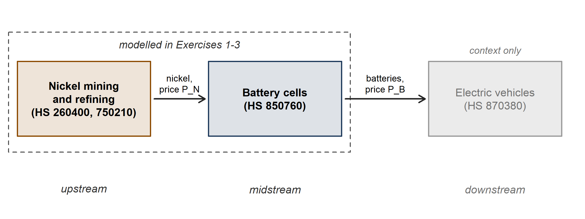
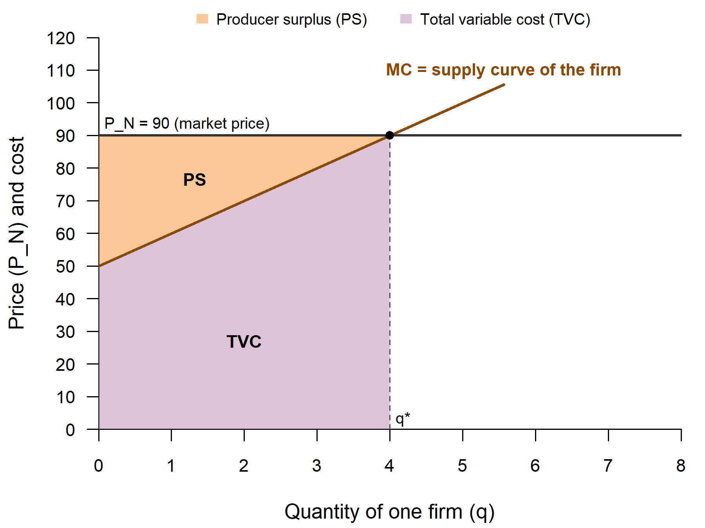
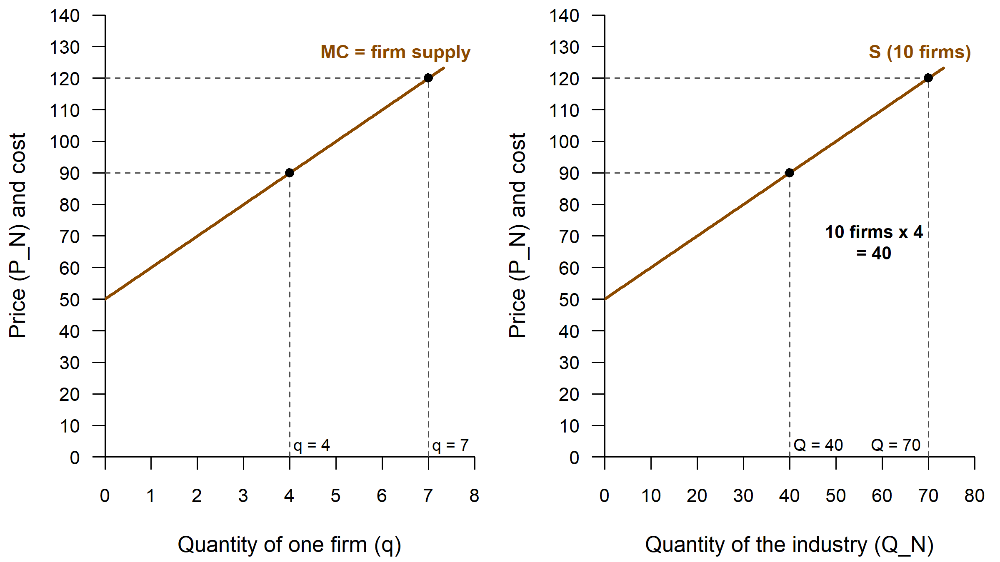
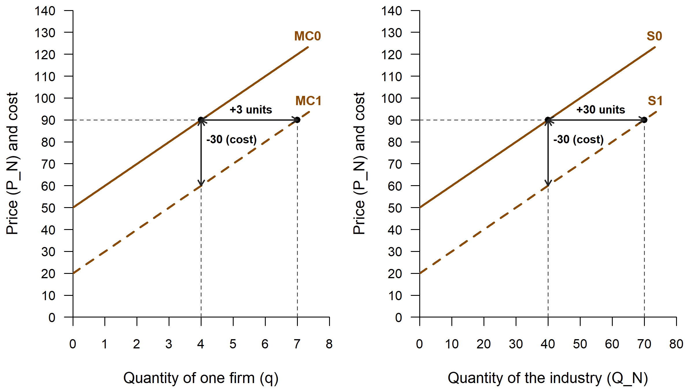
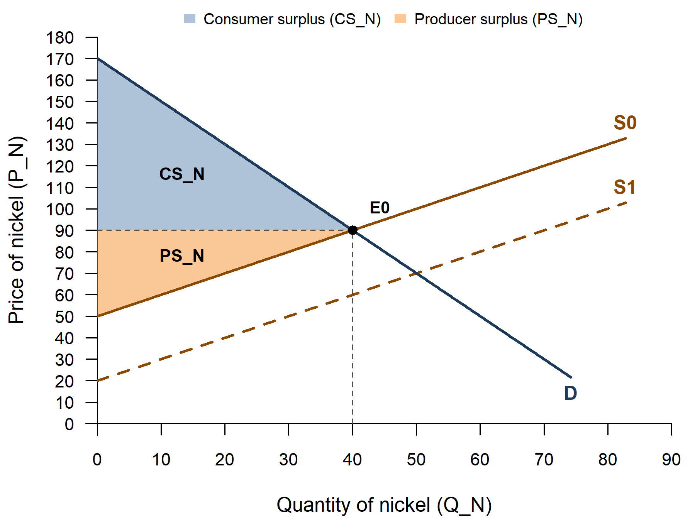
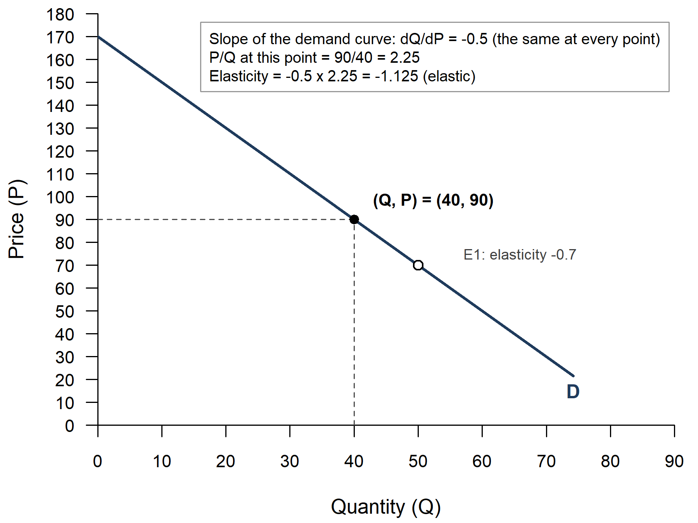
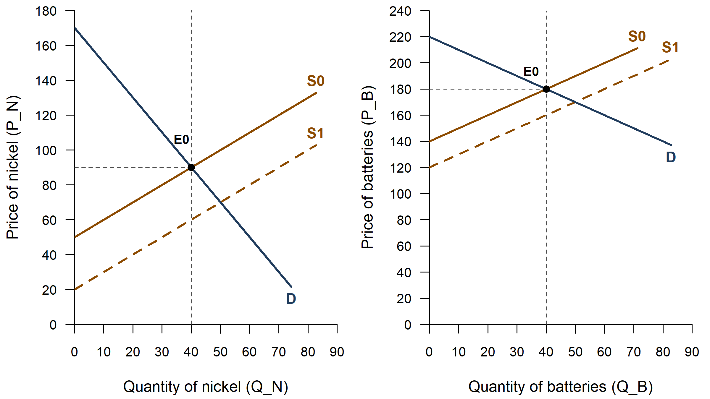
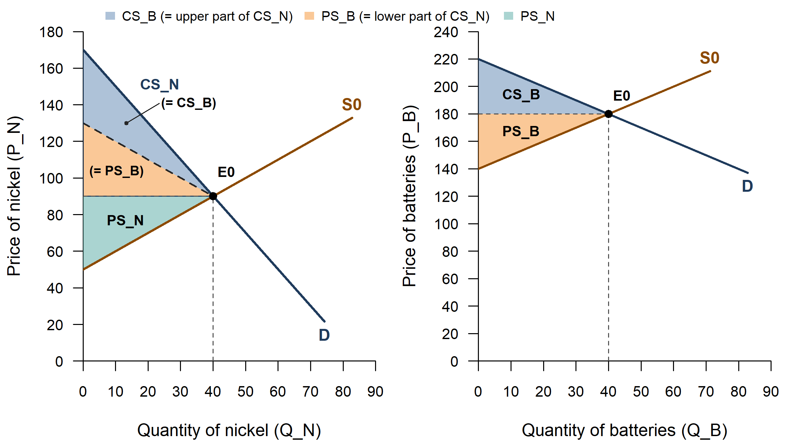

<!--
  NOTE FOR MAINTENANCE (this comment is not shown on the website)
  - The static figures are made by code/tutorial02_figures.R (run
    code/master.R in RStudio; Part 4 makes the Tutorial 2 figures). The page
    shows only the STUDENT versions (file names ending in _student.png where
    a tutor version exists), the same PNGs as in the student handout.
  - Figure numbers on this page follow the student handout (12 Oct 2026),
    NOT the internal file names: handout Figure 4 = fig04a, Figure 5 =
    fig06, Figure 6 = fig07. fig03b (innovation shift) and fig05
    (elasticity) are not in the student handout and are marked as such;
    fig04b and fig07b (the "after" figures) are not shown on this page.
  - This page has TWO apps ({shinylive-r} chunks): App A, the
    single-market explorer (handout Figures 2-4 and "Slope versus
    elasticity"), and App B, the linked-markets explorer (handout Figures 5
    and 6). Each app loads its own copy of R in the browser, so a page
    should hold at most two apps.
  - Shinylive apps must be self-contained, so each chunk contains two
    "files":
      app.R               - the user interface and server (written here)
      functions_models.R  - pulled in from ../code/functions_models.R by
                            Quarto's include shortcode when the site is
                            rendered (Part 5 there: Model D, the
                            nickel-battery chain), so the apps always use
                            the same model and drawing code as the handout
                            figures.
  - The slider defaults are the handout values (list "handout" at the top
    of each app.R): if the handout parameters in code/tutorial02_figures.R
    change, change them there too.
  - To try an app on your computer as a normal Shiny app before pushing,
    switch on Part 14 (code/app_test.R) in code/master.R and set app_qmd to
    this page there (app_chunk = 1: single-market explorer, 2:
    linked-markets explorer).
-->

Tutorial 1 analysed one competitive market on its own. This tutorial connects two markets along a value chain: an *upstream* market for an input (nickel) and a *downstream* market for a product made from it (batteries). Each battery needs one unit of nickel, so the two markets trade the same quantity. We ask how an innovation that lowers the cost of producing nickel travels down the chain: how much of the cost saving reaches the nickel price and then the battery price (*cost pass-through*), and who gains in each market. The same two-market set-up returns in later tutorials for trade policy, industrial policy and foreign direct investment.

{fig-alt="Three boxes from left to right: nickel mining and refining (upstream), battery cells (midstream) and electric vehicles (downstream, greyed out as context only). Arrows carry nickel at price P_N and batteries at price P_B. A dashed frame around the first two boxes reads modelled in Exercises 1-3." width="95%"}

::: {.callout-note}
## How to use this page

- The page has **two interactive explorers**. They run entirely in your browser. **The first time, each may take 10-30 seconds to load.**
- **Explorer A** follows Exercises 1 and 2 (one nickel producer, the nickel industry, the nickel market). **Explorer B** follows Exercise 3 (the nickel and battery markets together).
- Choose a figure or view, then move the sliders: the diagram and the numbers update immediately. The button "Reset to the handout values" brings back the handout figure.
- Below each explorer, the **static figures** are the same as in the tutorial handout, each with the key idea in a few sentences.
:::

## Explorer A: one market at a time {#explorer-a}

```{shinylive-r}
#| standalone: true
#| viewerHeight: 820

## file: app.R
# ---------------------------------------------------------------------------
# Tutorial 2, Explorer A: the single-market figures of the handout
# (Figure 2 one nickel producer, Figure 3 from the firm to the industry,
# Figure 4 the nickel market, and "Slope versus elasticity").
# The figures are drawn by draw_chain_firm(), draw_chain_supply(),
# draw_chain_nickel() and draw_chain_elasticity() in functions_models.R
# (bundled below): the same functions that make the handout PNGs. Each
# returns its numbers invisibly; the table under the plot shows them.
# ---------------------------------------------------------------------------
library(shiny)
source("functions_models.R")   # draw_chain_*(), chain_fmt(), ...

# ---- Settings ---------------------------------------------------------------
# One nickel firm: MC = c0 + d*q = 50 + 10q, fixed cost 20 (handout
# Exercise 1). Fixed axes per figure, a little wider than in the handout so
# that the curves stay in view when the sliders move.
firm_c0 <- 50; firm_d <- 10; firm_FC <- 20
# (firm: price axis to 160, so that the MC line, which stops at 88% of the
# axis, still reaches q* at the top slider price 130)
ax_firm   <- list(xlim = c(0, 10), ylim = c(0, 160))
ax_supply <- list(xlim_firm = c(0, 10), xlim_industry = c(0, 160),
                  ylim = c(0, 140))
ax_nickel <- list(xlim = c(0, 120), ylim = c(0, 180))
nickel_E0 <- c(40, 90)          # the curves pivot around E0 = (40, 90)

# Handout values: every input starts here; the Reset button comes back
handout <- list(P = 90, n = 10, k = 30, b = 2, s = 1, Pe = 90)

# Slope versus elasticity: the price slider's range and the axes of each
# demand curve. The price axes are taller than in the drawing function's
# default (210 instead of 180, 70 instead of 50), so that the box with the
# numbers at the top never hides the point or the second marker. The
# slider stops where the drawn demand line ends (it stops a little above
# the quantity axis), so the point always sits on the line.
pe_range <- list(nickel  = list(min = 30, max = 140, value = 90),
                 example = list(min = 10, max = 45,  value = 20))
ax_elast <- list(nickel  = list(xlim = c(0, 90),  ylim = c(0, 210)),
                 example = list(xlim = c(0, 100), ylim = c(0, 70)))

figure_choices <- c(
  "Figure 2 - one nickel producer"          = "firm",
  "Figure 3 - from the firm to the industry" = "supply",
  "Figure 4 - the nickel market"            = "nickel",
  "Slope versus elasticity"                 = "elasticity")

# The key message of each view (from the handout), shown above the plot
figure_text <- c(
  firm = "A price-taking nickel producer makes q* where the price equals marginal cost (P_N = MC). Total variable cost (TVC) is the area under MC up to q*, producer surplus (PS) the area between the price line and MC. Profit = PS - fixed cost.",
  supply = "At every price, the industry supplies n times what one firm supplies (horizontal summation), so the industry supply curve is n times flatter than one firm's MC curve. Tick the box to see the innovation: both curves shift down by k.",
  nickel = "Demand and supply pivot around E0 = (40, 90) when you change their steepness. The innovation shifts supply down by k (S0 to S1). The share of k that reaches the price, the pass-through rate, is b/(b + s). The extremes: b = 0 (flat demand) and the tick box for a vertical demand curve.",
  elasticity = "A straight demand curve has the same slope dQ/dP everywhere, but its elasticity (dQ/dP) x (P/Q) changes along the curve: moving up the curve, demand becomes more elastic.")

# ---- User interface: what students see ------------------------------------
# sidebarLayout puts the controls on the left on a laptop; on a narrow phone
# screen the sidebar automatically moves above the plot.
ui <- fluidPage(
  sidebarLayout(
    sidebarPanel(
      width = 4,
      selectInput("fig", "Figure", choices = figure_choices,
                  selected = "firm"),
      conditionalPanel("input.fig == 'firm'",
        sliderInput("P", "Market price of nickel (P_N)",
                    min = 50, max = 130, value = handout$P, step = 5)),
      conditionalPanel("input.fig == 'supply'",
        sliderInput("n", "Number of nickel producers (n)",
                    min = 1, max = 20, value = handout$n, step = 1),
        checkboxInput("innov", "Show the innovation (cost falls by k)",
                      value = FALSE)),
      conditionalPanel("input.fig == 'nickel'",
        radioButtons("panel", "Surplus shown at",
                     choices = c("E0, before the innovation" = "before",
                                 "E1, after the innovation" = "after"),
                     selected = "before")),
      conditionalPanel("(input.fig == 'supply' && input.innov) || input.fig == 'nickel'",
        sliderInput("k", "Cost reduction per unit from the innovation (k)",
                    min = 0, max = 50, value = handout$k, step = 5)),
      conditionalPanel("input.fig == 'nickel'",
        sliderInput("b", "Steepness of nickel demand (b): 0 = flat, 4 = steep",
                    min = 0, max = 4, value = handout$b, step = 0.25),
        checkboxInput("vertical",
                      "Perfectly inelastic (vertical) demand (the b slider is then ignored)",
                      value = FALSE),
        sliderInput("s", "Steepness of nickel supply (s)",
                    min = 0, max = 2, value = handout$s, step = 0.25),
        checkboxInput("show_cs", "Show consumer surplus (CS_N)", value = TRUE),
        checkboxInput("show_ps", "Show producer surplus (PS_N)", value = TRUE)),
      conditionalPanel("input.fig == 'elasticity'",
        radioButtons("curve", "Demand curve",
                     choices = c("Nickel demand (P = 170 - 2Q)" = "nickel",
                                 "Appendix C example (Q = 100 - 2P)" = "example"),
                     selected = "nickel"),
        sliderInput("Pe", "Price: move the point along the curve (P)",
                    min = pe_range$nickel$min, max = pe_range$nickel$max,
                    value = pe_range$nickel$value, step = 5)),
      actionButton("reset", "Reset to the handout values", class = "btn-sm")
    ),
    mainPanel(
      width = 8,
      # On a phone the plot is drawn wider than the screen and scaled down
      # (see plot_width below), so that its labels do not run into each other
      tags$style("#fig_plot img { max-width: 100%; height: auto; }"),
      uiOutput("fig_text"),
      plotOutput("fig_plot", height = "auto"),
      tableOutput("fig_table")
    )
  )
)

# ---- Helpers: draw the chosen figure, and its table of numbers --------------
# Numbers in the table: at most 2 decimals, a comma for thousands
fmt_num <- function(x) {
  if (is.null(x) || length(x) != 1 || is.na(x)) return("-")
  chain_fmt(x)
}
fmt_share <- function(x) {           # 0.6667 -> "0.67 (67%)"
  if (is.null(x) || length(x) != 1 || is.na(x)) return("not determined")
  paste0(chain_fmt(x), " (", chain_fmt(100 * x, 0), "%)")
}
fmt_point <- function(Q, P) {
  if (is.na(Q) || is.na(P)) return("not determined")
  paste0("(", chain_fmt(Q), ", ", chain_fmt(P), ")")
}
make_table <- function(rows) {
  data.frame(Measure = names(rows),
             Value = vapply(rows, function(v) if (is.character(v)) v
                            else fmt_num(v), character(1)),
             check.names = FALSE, row.names = NULL)
}

# Draw one view; returns the drawing function's numbers (invisibly)
draw_figure <- function(fig, input) {
  switch(fig,
    firm = draw_chain_firm(P = input$P, c0 = firm_c0, d = firm_d,
                           FC = firm_FC, xlim = ax_firm$xlim,
                           ylim = ax_firm$ylim, tick_step = NULL,
                           fit_top = FALSE, version = "student"),
    supply = draw_chain_supply(what = if (isTRUE(input$innov)) "innovation"
                                      else "firm_industry",
                               c0 = firm_c0, d = firm_d, n_firms = input$n,
                               k = input$k, prices = c(90, 120),
                               xlim_firm = ax_supply$xlim_firm,
                               xlim_industry = ax_supply$xlim_industry,
                               ylim = ax_supply$ylim, tick_step = NULL,
                               fit_top = FALSE, version = "student"),
    # (the tick box "vertical demand" passes b = Inf: a vertical demand
    # curve at Q = 40, whatever the b slider says)
    nickel = draw_chain_nickel(panel = input$panel,
                               b = if (isTRUE(input$vertical)) Inf else input$b,
                               s = input$s,
                               k = input$k, E0 = nickel_E0,
                               xlim = ax_nickel$xlim, ylim = ax_nickel$ylim,
                               tick_step = NULL, fit_top = FALSE,
                               version = "student", show_cs = input$show_cs,
                               show_ps = input$show_ps),
    elasticity = draw_chain_elasticity(curve = input$curve, P = input$Pe,
                                       xlim = ax_elast[[input$curve]]$xlim,
                                       ylim = ax_elast[[input$curve]]$ylim,
                                       tick_step = NULL, fit_top = FALSE,
                                       version = "student"))
}

# The table of a view, from the numbers the drawing function returned
figure_table <- function(fig, o, input) {
  if (fig == "firm") {
    return(make_table(list(
      "Market price P_N" = o$P,
      "Best quantity q* (where P_N = MC)" = o$Q_star,
      "Total revenue TR = P_N x q*" = o$TR_star,
      "Total variable cost TVC (area under MC up to q*)" = o$TVC_star,
      "Producer surplus PS = TR - TVC" = o$PS,
      "Fixed cost FC" = o$FC,
      "Profit = PS - FC (negative = loss)" = o$profit_star)))
  }
  if (fig == "supply") {
    rows <- list(
      "Number of producers n" = input$n,
      "Slope of one firm's MC curve (d)" = firm_d,
      "Slope of the industry supply curve (d/n)" = o$industry_slope,
      "Industry supply curve" = paste0("P_N = ", chain_fmt(firm_c0), " + ",
                                       chain_fmt(o$industry_slope), " x Q_N"),
      "At P_N = 90: one firm q / industry Q" =
        paste0(chain_fmt(o$q[1]), " / ", chain_fmt(o$Q[1])),
      "At P_N = 120: one firm q / industry Q" =
        paste0(chain_fmt(o$q[2]), " / ", chain_fmt(o$Q[2])))
    if (isTRUE(input$innov)) {
      rows <- c(rows, list(
        "After the innovation: industry supply curve" =
          paste0("P_N = ", chain_fmt(firm_c0 - input$k), " + ",
                 chain_fmt(o$industry_slope), " x Q_N"),
        "After the innovation, at P_N = 90: one firm q / industry Q" =
          paste0(chain_fmt(o$q_after), " / ", chain_fmt(o$Q_after))))
    }
    return(make_table(rows))
  }
  if (fig == "nickel") {
    # (vertical demand, b = Inf: no price intercept and CS not defined)
    vert <- isTRUE(o$vertical)
    rows <- list(
      "Demand curve" = if (vert) {
        paste0("Q_N = ", chain_fmt(o$Q0), " at every price (vertical)")
      } else {
        paste0("P_N = ", chain_fmt(o$A), " - ", chain_fmt(o$b), " x Q_N")
      },
      "Supply before (S0) / after (S1)" =
        paste0("P_N = ", chain_fmt(o$u), " + ", chain_fmt(o$s),
               " x Q_N  /  P_N = ", chain_fmt(o$u1), " + ", chain_fmt(o$s),
               " x Q_N"),
      "E0 = (Q, P_N) before" = fmt_point(o$Q0, o$P0),
      "E1 = (Q, P_N) after" = fmt_point(o$Q1, o$P1),
      "Change in quantity" = o$dQ,
      "Change in price" = o$dP,
      "Consumer surplus CS_N before / after" = if (vert) "not defined" else
        paste0(fmt_num(o$CS0), " / ", fmt_num(o$CS1)),
      "Producer surplus PS_N before / after" =
        paste0(fmt_num(o$PS0), " / ", fmt_num(o$PS1)),
      "Pass-through rate b/(b + s)" = fmt_share(o$rho))
    msg <- if (o$indeterminate) {
      "Both curves are flat: the new equilibrium is not determined."
    } else if (o$k == 0) {
      "No cost reduction (k = 0): nothing changes."
    } else {
      paste0("Of the cost reduction of ", chain_fmt(o$k), ", ",
             chain_fmt(-o$dP), " reaches the price (rho = ",
             chain_fmt(o$rho), ").")
    }
    rows <- c(rows, list("In words" = msg))
    if (isTRUE(o$negative_cost)) {
      rows <- c(rows, list("Note" = paste0("S1 starts below zero: with these ",
        "values the first units of nickel would cost less than nothing.")))
    }
    return(make_table(rows))
  }
  # Slope versus elasticity (P/Q and the elasticity with 3 decimals, as in
  # the box in the plot and the handout: -1.125, not -1.12)
  fmt3 <- function(x) if (is.na(x)) "-" else chain_fmt(x, 3)
  make_table(list(
    "Price P" = o$P,
    "Quantity Q at this price" = o$Q,
    "Slope dQ/dP (the same at every point)" = o$slope,
    "P/Q at this point" = fmt3(o$P_over_Q),
    "Elasticity (dQ/dP) x (P/Q)" = fmt3(o$elasticity),
    "Elastic or inelastic?" = o$word))
}

# ---- Server: what happens when a slider moves -----------------------------
server <- function(input, output, session) {

  # The numbers of the figure drawn last (the drawing functions return them)
  last_out <- reactiveVal(NULL)

  # Slope versus elasticity: a new curve gets its own price range
  observeEvent(input$curve, {
    r <- pe_range[[input$curve]]
    updateSliderInput(session, "Pe", min = r$min, max = r$max, value = r$value)
  }, ignoreInit = TRUE)

  # Reset: every input back to its handout value
  observeEvent(input$reset, {
    for (nm in c("P", "n", "k", "b", "s")) {
      updateSliderInput(session, nm, value = handout[[nm]])
    }
    updateCheckboxInput(session, "innov", value = FALSE)
    updateCheckboxInput(session, "vertical", value = FALSE)
    updateCheckboxInput(session, "show_cs", value = TRUE)
    updateCheckboxInput(session, "show_ps", value = TRUE)
    updateRadioButtons(session, "panel", selected = "before")
    updateRadioButtons(session, "curve", selected = "nickel")
    r <- pe_range$nickel
    updateSliderInput(session, "Pe", min = r$min, max = r$max, value = r$value)
  })

  output$fig_text <- renderUI({
    p(figure_text[[input$fig]], style = "margin-bottom: 6px;")
  })

  # Plot size: the width of the page column, but at least 460 pixels (600
  # for the two-panel Figure 3; on a phone the picture is then scaled down
  # to fit, see tags$style above); the height follows the width
  two_panel <- function() identical(input$fig, "supply")
  plot_width <- function() {
    w <- session$clientData$output_fig_plot_width
    w_min <- if (two_panel()) 600 else 460
    if (is.null(w) || w <= 0) 500 else max(w, w_min)
  }
  plot_height <- function() {
    if (two_panel()) min(440, round(0.56 * plot_width() + 20))
    else min(480, round(0.75 * plot_width() + 20))
  }

  output$fig_plot <- renderPlot({
    # Right after the demand curve changes, the price slider may still hold
    # the old curve's value for a moment: wait for the new one
    if (input$fig == "elasticity") {
      r <- pe_range[[input$curve]]
      req(input$Pe >= r$min, input$Pe <= r$max, cancelOutput = TRUE)
    }
    # tryCatch: if a combination of values cannot be drawn, say so in the
    # plot area instead of showing an R error
    out <- tryCatch(draw_figure(input$fig, input), error = function(e) {
      op <- par(mar = c(0, 0, 0, 0)); on.exit(par(op))
      plot.new()
      text(0.5, 0.5, paste0("This combination of values cannot be drawn:\n",
                            conditionMessage(e),
                            "\nPlease try other slider values."), cex = 0.95)
      NULL
    })
    last_out(if (is.null(out)) NULL
             else list(fig = input$fig, out = out))
  }, res = 96, width = plot_width, height = plot_height)   # res = 96: comfortable text on screen

  output$fig_table <- renderTable({
    lo <- last_out()
    if (is.null(lo) || lo$fig != input$fig) return(NULL)
    tryCatch(figure_table(lo$fig, lo$out, input), error = function(e) NULL)
  }, striped = TRUE, spacing = "xs", width = "100%", align = "lr")
}

shinyApp(ui, server)

## file: functions_models.R

```

### Exercise 1: from one nickel producer to the industry

Each nickel producer has the cost function TC(q) = 20 + 50q + 5q², so its marginal cost is MC = 50 + 10q. A price-taking firm produces up to the quantity q\* where the market price equals marginal cost (P_N = MC): this MC curve is the firm's supply curve. Total variable cost is the area under MC up to q\*, producer surplus the area between the price line and MC. Profit is producer surplus minus the fixed cost.

{fig-alt="One firm's rising marginal cost line MC = 50 + 10q, labelled as the supply curve of the firm, and a horizontal price line at P_N = 90. They cross at q*. The area under MC up to q* is shaded purple (TVC), the area between the price line and MC orange (PS)." width="85%"}

*Explore: choose **Figure 2** in [Explorer A](#explorer-a) above.*

At any price, the industry supplies the sum of what its 10 identical firms supply: 10 times one firm's quantity (*horizontal summation*). At P = 90 one firm supplies 4 units and the industry 40. The industry supply curve P_N = 50 + Q_N is therefore ten times flatter than one firm's MC curve: to get one more unit out of the industry, each firm only has to produce 0.1 units more, which raises its marginal cost by only £1.

{fig-alt="Two panels with the same price axis. Left: one firm's MC line from 50 with slope 10; at P = 90 the firm supplies q = 4, at P = 120 q = 7. Right: the industry supply curve S of 10 firms from 50 with slope 1; at P = 90 the industry supplies Q = 40, at P = 120 Q = 70. A note reads 10 firms x 4 = 40." width="95%"}

*Explore: choose **Figure 3** in [Explorer A](#explorer-a) above.*

An innovation lowers every producer's marginal cost by £30 at every output level. Both supply curves shift down by exactly the cost reduction (P = 50 + Q before, P = 20 + Q after): a shift of the curve, not a movement along it. Seen horizontally, at the same price every firm supplies 3 units more and the industry 30 units more.

{fig-alt="Two panels. Left: the firm's marginal cost before (MC0) and after (MC1, dashed) the innovation, 30 lower at every quantity; at P = 90 the firm supplies 3 units more. Right: industry supply S0 and S1, 30 lower; at P = 90 the industry supplies 30 units more. Vertical arrows show the cost fall, horizontal arrows the extra quantity." width="95%"}

*Explore: in **Figure 3** of [Explorer A](#explorer-a), tick "Show the innovation (cost falls by k)".*

### Exercise 2: the nickel market and cost pass-through

Nickel demand is P_N = 170 - 2Q_N; supply is P_N = 50 + Q_N before the innovation and P_N = 20 + Q_N after. The innovation changes the cost function, hence the supply curve; the demand curve is the same before and after. Before the innovation the market clears at E0 = (40, 90). With straight-line curves, consumer and producer surplus are triangles: CS = ½ × Q\* × (demand intercept - P\*), PS = ½ × Q\* × (P\* - supply intercept).

{fig-alt="The nickel market: demand D falling from 170, supply S0 rising from 50 and the dashed supply S1 rising from 20. Demand and S0 cross at E0 = (40, 90). Consumer surplus CS_N (blue) lies between demand and the price 90, producer surplus PS_N (orange) between the price and S0." width="85%"}

*Explore: choose **Figure 4** in [Explorer A](#explorer-a) above; the radio button "E1, after the innovation" shades the surpluses at the new equilibrium.*

The marginal cost of every unit falls by 30, but the price falls by less: the pass-through rate is ρ = b/(b + s), where b and s are the slopes (steepness) of the inverse demand and supply curves. It depends only on how steep demand is relative to supply. No firm "decides" to keep part of the saving: every firm is a price taker, and the extra output moves the market up the new supply curve. In the explorer, the sliders b and s turn demand and supply around E0 = (40, 90), so you can compare a flat with a steep demand curve (Question 2.3c).

The slope of a curve depends on the units used; the elasticity, (dQ/dP) × (P/Q), does not. A straight line has one slope but a different elasticity at every point. On the nickel demand curve Q_N = 85 - 0.5P_N, the slope is -0.5 everywhere, but the elasticity is -1.125 at E0 (elastic) and different at every other price.

{fig-alt="The nickel demand curve D with the point (Q, P) = (40, 90) marked and a hollow marker at the second point E1. A box at the top right reads: slope of the demand curve dQ/dP = -0.5 (the same at every point); P/Q at this point = 90/40 = 2.25; elasticity = -0.5 x 2.25 = -1.125 (elastic)." width="85%"}

*Explore: choose **Slope versus elasticity** in [Explorer A](#explorer-a) above; the radio button switches to the Appendix C example Q = 100 - 2P.*

**Things to try in Explorer A**

1. **Profit and producer surplus.** In Figure 2, lower the market price P_N from 90 to 60. Does the firm still produce? What happens to its profit, and why does it keep producing at a loss?
2. **Few or many firms.** In Figure 3, compare n = 1 with n = 20. How does the slope of the industry supply curve change, and how much does the industry supply at P_N = 90?
3. **Who gets the cost saving?** In Figure 4, set b = 4 and s = 0.25 (steep demand, flat supply), then b = 0.25 and s = 2. How much of the cost reduction of 30 reaches the price in each case?
4. **The two extremes (Question 2.3c).** In Figure 4, with s = 1 and k = 30, tick "Perfectly inelastic (vertical) demand" and switch between E0 and E1: how far does the price fall, does the quantity change, and what happens to producer surplus? Then untick it and set b = 0 (horizontal demand). Where does the adjustment happen now? Why is consumer surplus "not defined" with vertical demand?
5. **Same slope, different elasticity.** In "Slope versus elasticity", move the price from 90 down to 70 and up to 120. The slope stays the same: why does the elasticity change? Then switch to the Appendix C example and compare P = 20 with P = 40.

## Explorer B: the two linked markets {#explorer-b}

```{shinylive-r}
#| standalone: true
#| viewerHeight: 820

## file: app.R
# ---------------------------------------------------------------------------
# Tutorial 2, Explorer B: the nickel and battery markets together
# (handout Figure 5, the two linked markets, and Figure 6, welfare in both
# markets). The figure is drawn by draw_chain_linked() in
# functions_models.R (bundled below), the function that makes the handout
# PNGs; it returns all numbers (from chain_outcomes()) invisibly, and the
# tables under the plot show them.
# ---------------------------------------------------------------------------
library(shiny)
source("functions_models.R")   # draw_chain_linked(), chain_outcomes(), ...

# ---- Settings ---------------------------------------------------------------
# Fixed parts of the model (handout Exercise 3): battery demand
# P_B = A - b*Q with A = 220; other battery cost c + g*Q with c = 50; nickel
# supply P_N = u + s*Q with u = 50. Fixed axes: the quantity axis goes to
# 130 (wider than the handout's 90), so that every equilibrium the sliders
# can reach stays in view: the largest Q is 113.3 (b = g = s = 0.5,
# k = 50), and the lines stop at 92% of the axis (119.6), beyond it.
chain_A <- 220; chain_c <- 50; chain_u <- 50
ax <- list(xlim = c(0, 130), ylim_N = c(0, 180), ylim_B = c(0, 240))

# Handout values: every slider starts here; the Reset button comes back
handout <- list(k = 30, b = 1, g = 1, s = 1)

# ---- User interface: what students see ------------------------------------
ui <- fluidPage(
  sidebarLayout(
    sidebarPanel(
      width = 4,
      radioButtons("show", "What to show",
                   choices = c("Curves (Figure 5)" = "curves",
                               "Welfare areas (Figure 6)" = "welfare"),
                   selected = "curves"),
      conditionalPanel("input.show == 'welfare'",
        radioButtons("at", "Equilibrium",
                     choices = c("E0, before the innovation" = "before",
                                 "E1, after the innovation" = "after"),
                     selected = "before")),
      sliderInput("k", "Cost reduction per unit of nickel (k)",
                  min = 0, max = 50, value = handout$k, step = 5),
      sliderInput("b", "Steepness of battery demand (b)",
                  min = 0.5, max = 3, value = handout$b, step = 0.25),
      sliderInput("g", "How fast other battery costs rise with output (g)",
                  min = 0.5, max = 3, value = handout$g, step = 0.25),
      sliderInput("s", "Steepness of nickel supply (s)",
                  min = 0.5, max = 3, value = handout$s, step = 0.25),
      actionButton("reset", "Reset to the handout values", class = "btn-sm")
    ),
    mainPanel(
      width = 8,
      tags$style("#fig_plot img { max-width: 100%; height: auto; }"),
      uiOutput("fig_text"),
      plotOutput("fig_plot", height = "auto"),
      tableOutput("eq_table"),
      tableOutput("pt_table")
    )
  )
)

# ---- Helpers ----------------------------------------------------------------
# Numbers in the tables: at most 2 decimals, a comma for thousands
fmt_num <- function(x) {
  if (is.null(x) || length(x) != 1 || is.na(x)) return("-")
  chain_fmt(x)
}
fmt_change <- function(x) {          # "+450", "-20", "0"
  if (is.null(x) || length(x) != 1 || is.na(x)) return("-")
  if (round(x, 2) > 0) paste0("+", chain_fmt(x)) else chain_fmt(x)
}
fmt_share <- function(x) {           # 0.6667 -> "0.67 (67%)"
  if (is.null(x) || length(x) != 1 || is.na(x)) return("not determined")
  paste0(chain_fmt(x), " (", chain_fmt(100 * x, 0), "%)")
}

# Equilibria and the welfare ledger: before, after, change
eq_table <- function(o) {
  rows <- list(
    "Nickel price P_N"                   = "P_N",
    "Quantity Q (= Q_N = Q_B)"           = "Q",
    "Battery price P_B"                  = "P_B",
    "Nickel producers (PS_N)"            = "PS_N",
    "Battery producers (PS_B)"           = "PS_B",
    "Battery buyers (CS_B)"              = "CS_B",
    "Society: net social benefit PS_N + PS_B + CS_B" = "NSB",
    "Memo: nickel buyers' surplus CS_N (= CS_B + PS_B, not added)" = "CS_N")
  data.frame(
    Measure = names(rows),
    "Before (E0)" = vapply(rows, function(v) fmt_num(o$before[[v]]), ""),
    "After (E1)"  = vapply(rows, function(v) fmt_num(o$after[[v]]), ""),
    Change = vapply(rows, function(v) fmt_change(o$after[[v]] - o$before[[v]]), ""),
    check.names = FALSE, row.names = NULL)
}

# The three pass-through rates
pt_table <- function(o) {
  data.frame(
    "Pass-through" = c(
      "Upstream: nickel price fall / k = (b + g)/(b + g + s)",
      "Downstream: battery price fall / nickel price fall = b/(b + g)",
      "Whole chain: battery price fall / k = b/(b + g + s)"),
    Value = c(fmt_share(o$rho_N), fmt_share(o$rho_B), fmt_share(o$rho_total)),
    check.names = FALSE, row.names = NULL)
}

# ---- Server: what happens when a slider moves -----------------------------
server <- function(input, output, session) {

  last_out <- reactiveVal(NULL)   # the numbers of the figure drawn last

  observeEvent(input$reset, {
    for (nm in names(handout)) {
      updateSliderInput(session, nm, value = handout[[nm]])
    }
    updateRadioButtons(session, "show", selected = "curves")
    updateRadioButtons(session, "at", selected = "before")
  })

  output$fig_text <- renderUI({
    txt <- if (input$show == "curves") {
      "Left the nickel market (derived demand, supply before S0 and after S1), right the battery market (final demand, battery supply at each nickel price). The dashed vertical lines show that Q_N = Q_B. The cheaper nickel shifts the battery supply curve down."
    } else {
      "Welfare in both markets. The dashed line splits the nickel buyers' surplus CS_N into two parts; compare their colours with CS_B and PS_B in the battery market."
    }
    p(txt, style = "margin-bottom: 6px;")
  })

  # Two panels: at least 600 pixels wide (scaled down on a phone)
  plot_width <- function() {
    w <- session$clientData$output_fig_plot_width
    if (is.null(w) || w <= 0) 640 else max(w, 600)
  }
  plot_height <- function() min(440, round(0.56 * plot_width() + 20))

  output$fig_plot <- renderPlot({
    out <- tryCatch(
      draw_chain_linked(show = input$show, at = input$at, b = input$b,
                        g = input$g, s = input$s, k = input$k, A = chain_A,
                        c = chain_c, u = chain_u, xlim = ax$xlim,
                        ylim_N = ax$ylim_N, ylim_B = ax$ylim_B,
                        tick_step = NULL, fit_top = FALSE,
                        version = "student"),
      error = function(e) {
        op <- par(mar = c(0, 0, 0, 0)); on.exit(par(op))
        plot.new()
        text(0.5, 0.5, paste0("This combination of values cannot be drawn:\n",
                              conditionMessage(e),
                              "\nPlease try other slider values."), cex = 0.95)
        NULL
      })
    last_out(out)
  }, res = 96, width = plot_width, height = plot_height)

  output$eq_table <- renderTable({
    o <- last_out()
    if (is.null(o)) return(NULL)
    tryCatch(eq_table(o), error = function(e) NULL)
  }, striped = TRUE, spacing = "xs", width = "100%", align = "lrrr")

  output$pt_table <- renderTable({
    o <- last_out()
    if (is.null(o)) return(NULL)
    tryCatch(pt_table(o), error = function(e) NULL)
  }, striped = TRUE, spacing = "xs", width = "100%", align = "lr")
}

shinyApp(ui, server)

## file: functions_models.R

```

### Exercise 3: linking the nickel and the battery market

Each battery needs one unit of nickel, so the nickel price enters the battery producer's cost: the battery supply curve P_B = P_N + 50 + Q_B has one position for each nickel price. A fall in the nickel price shifts it down by the same amount. The demand for nickel is *derived* from the battery market: plugging battery demand P_B = 220 - Q_B into battery supply and solving for the nickel price gives P_N = 170 - 2Q_N, the nickel demand curve of Exercise 2. Its slope has two parts, one from battery demand (b) and one from the rising other costs of batteries (g).

{fig-alt="Two panels. Left, the nickel market: derived demand D falling from 170, supply S0 from 50 and the dashed S1 from 20, with E0 = (40, 90). Right, the battery market: demand D falling from 220, battery supply S0 from 140 and the dashed S1 from 120, with E0 at Q = 40. A dashed vertical line at Q = 40 runs through both panels." width="95%"}

*Explore: in [Explorer B](#explorer-b) above, choose "Curves (Figure 5)".*

The innovation travels down the chain in two stages, and at each stage only part of the cost change reaches the price: upstream, the share (b + g)/(b + g + s) of the cost reduction reaches the nickel price; downstream, the share b/(b + g) of the nickel price fall reaches the battery price. Final users receive b/(b + g + s), one third with the handout values; the rest is absorbed by the rising marginal costs of producing more at each stage.

{fig-alt="Two panels at E0. Left, the nickel market: the surplus of the nickel buyers below derived demand and above the price 90 is outlined and split by a dashed line into an upper blue part and a lower orange part; producer surplus PS_N (teal) lies between the price and supply. Right, the battery market: CS_B (blue) above the price 180, PS_B (orange) below it." width="95%"}

*Explore: in [Explorer B](#explorer-b) above, choose "Welfare areas (Figure 6)" and switch between E0 and E1.*

**Things to try in Explorer B**

1. **Other battery costs.** Set g = 0.5, then g = 3. How does the slope of the derived nickel demand curve change? Which pass-through rate changes most, and who gets more of the cost saving: battery buyers or nickel producers?
2. **Steep nickel supply.** Set s = 3. How much does the nickel price fall now? Compare the change in PS_N with the changes in PS_B and CS_B: who keeps most of the gain?
3. **Steep battery demand.** Compare b = 0.5 with b = 3. How does the battery price respond to the innovation in each case?
4. **No double counting.** In the welfare view, compare CS_N with CS_B + PS_B before and after the innovation, for any slider values. Why is CS_N left out of the net social benefit?

## Welfare across linked markets

With two markets, the welfare ledger must not count the same gain twice. The nickel buyers are the battery producers, and their surplus in the nickel market, CS_N, is exactly what they pass on as battery producer surplus and battery buyers' surplus: CS_N = CS_B + PS_B. The net social benefit therefore adds the surplus of each group once, along the whole chain (Table 3 of the handout):

| Group | Surplus | Before (E0) | After (E1) |
|:------|:-------:|:-----------:|:----------:|
| Nickel producers | PS_N | 800 | 1,250 |
| Battery producers | PS_B | | |
| Battery buyers | CS_B | | |
| Government | | 0 | 0 |
| External effects | | 0 | 0 |
| **Society (net social benefit)** | **PS_N + PS_B + CS_B** | | |
| *Memo: nickel buyers (not added)* | *CS_N = CS_B + PS_B* | *1,600* | *2,500* |

: Table 3: Welfare ledger for the nickel-battery value chain (£)

*Note: Complete the battery rows in Question 3.3 and check your answers with Explorer B. Government and external effects are zero because there is no intervention and, by assumption, no externalities; they become non-zero in later tutorials.*
