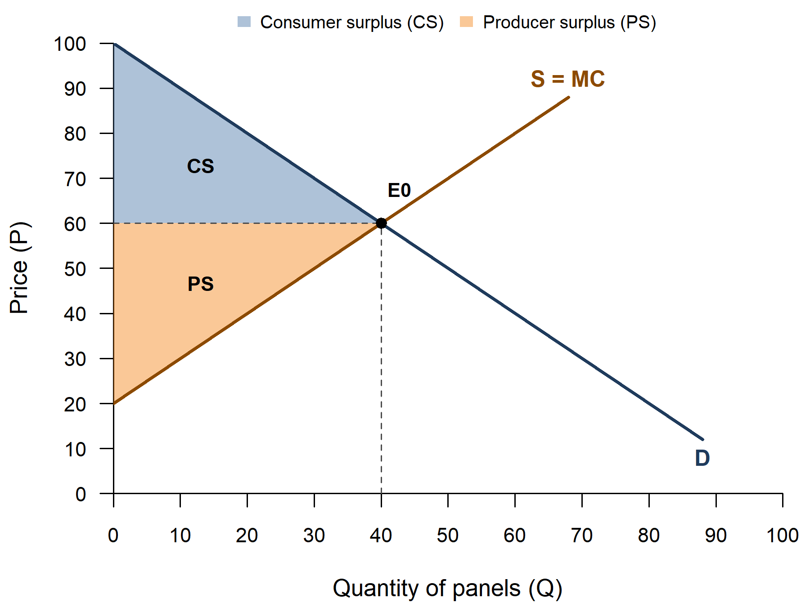
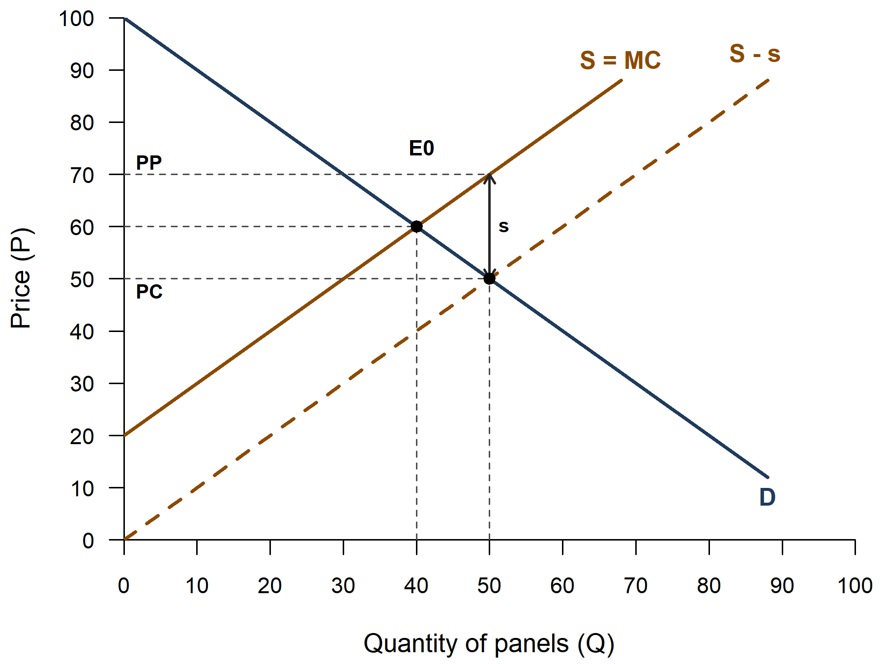
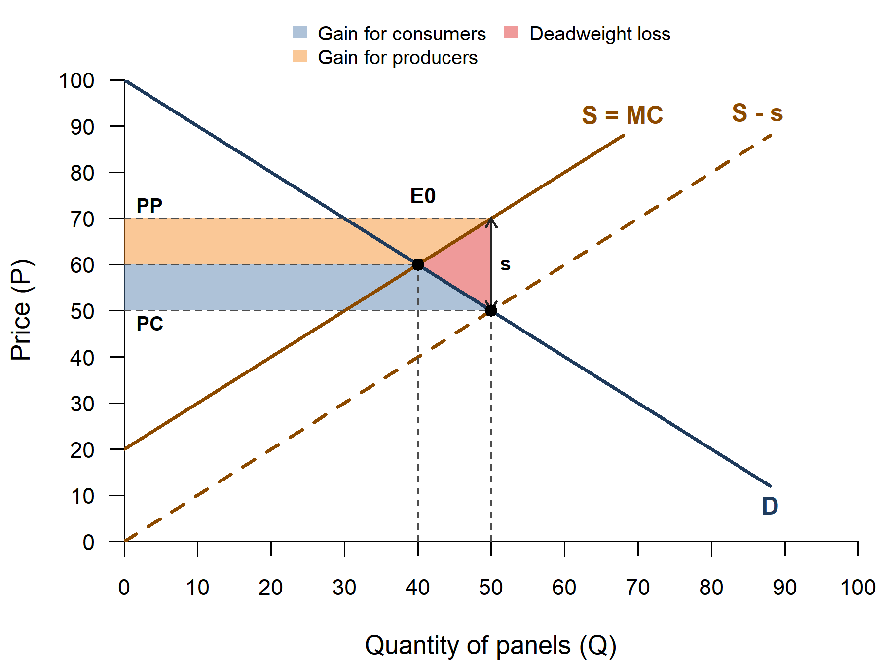
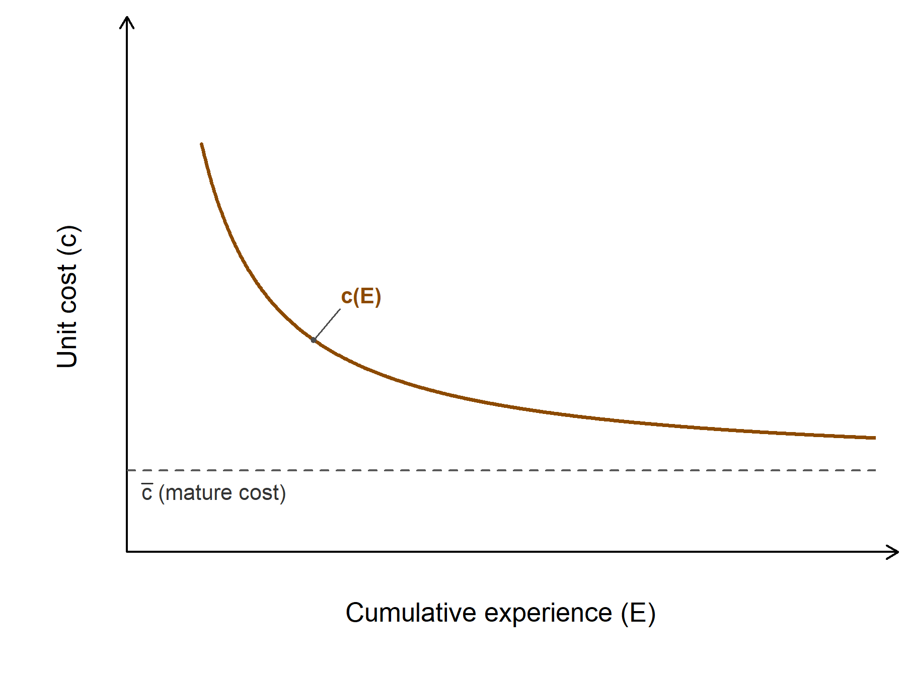
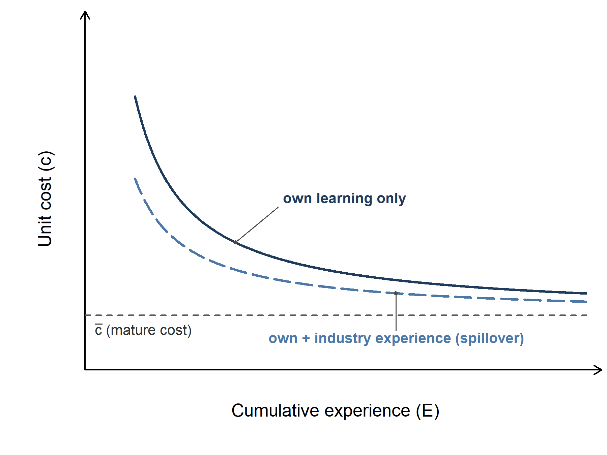
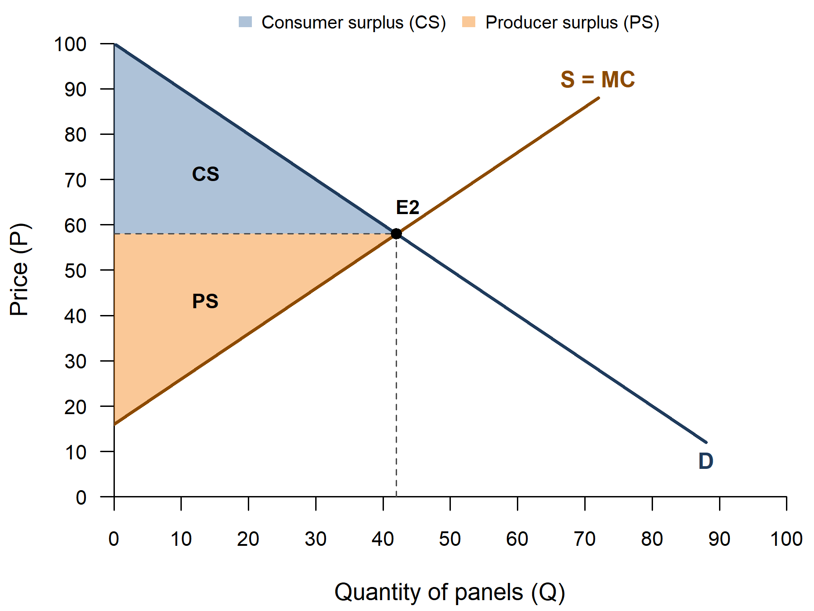
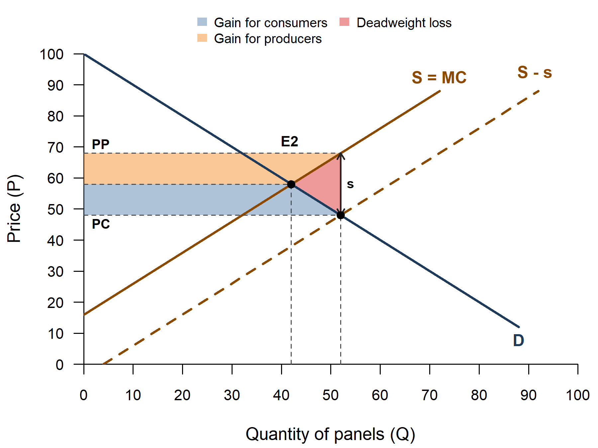
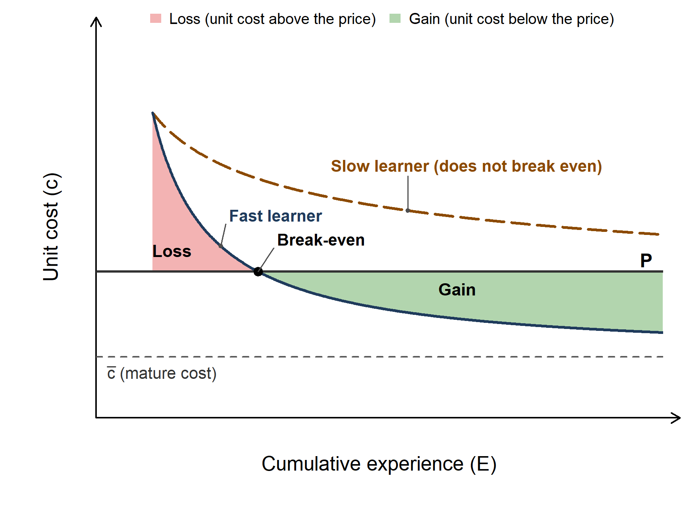

<!--
  NOTE FOR MAINTENANCE (this comment is not shown on the website)
  - The static figures are made by code/tutorial03_figures.R (run
    code/master.R in RStudio; Part 5 makes the Tutorial 3 figures). Each
    market figure exists in two versions, named after the two versions of
    the handout: _noanswers.png (handed out before the tutorial) and
    _answers.png (handed out after it). This page shows only the
    _noanswers versions; the learning-curve figures (fig03 to fig05) have
    no numbers and exist in one version only.
  - Figure numbers on this page follow the handout: Figure 2 (Question
    2.5) is the file fig02_subsidy_welfare, Figure 2a the file
    fig02a_subsidy_shift. Handout Figures 5 (period 2 without the
    subsidy, view "market" with c = 16, point named E2) and 6 (period 2
    with the subsidy kept, Question 3.6d) are the files fig06_period2_market
    and fig07_period2_subsidy_welfare; handout Figure 7 (break-even) is
    the file fig05_learning_breakeven (the handout numbers follow the
    text order, the file numbers the order the figures were made). Figures
    5 and 6 are not in the explorer, whose cost intercept is fixed at
    c = 20. The extra app view "Welfare levels" has no PNG.
  - The page has ONE app ({shinylive-r} chunk), the explorer. Shinylive
    apps must be self-contained, so the chunk contains two "files":
      app.R               - the user interface and server (written here)
      functions_models.R  - pulled in from ../code/functions_models.R by
                            Quarto's include shortcode when the site is
                            rendered (Part 6 there: Model E,
                            subsidy_outcomes() and draw_subsidy()), so the
                            app always uses the same model and drawing code
                            as the handout figures.
  - The slider defaults are the handout values (list "handout" at the top
    of app.R): if the handout parameters in code/tutorial03_figures.R
    change, change them there too. The app draws the "answers" version
    (with numbers): students use it after working through the questions.
  - To try the app on your computer as a normal Shiny app before pushing,
    switch on Part 14 (code/app_test.R) in code/master.R and set app_qmd to
    this page there (app_chunk = 1).
-->

Lecture 3 asks when governments should intervene in markets. The economist's answer starts from a benchmark: in a competitive market in which all costs and benefits are priced, the market outcome is efficient and intervention cannot raise total surplus. A rationale for intervention needs a *market failure*: one assumption of the benchmark that does not hold. This tutorial returns to one market, a stylised closed market for solar panels, and adds a government: first a per-unit subsidy in a market without any market failure (Exercise 2), then the same subsidy when producing today lowers everyone's costs tomorrow, *learning-by-doing* (Exercise 3).

::: {.callout-note}
## How to use this page

- The page has **one interactive explorer**. It runs entirely in your browser. **The first time, it may take 10-30 seconds to load.**
- Choose a figure, then move the sliders: the diagram and the tables update immediately. The button "Reset to the handout values" brings back the handout figure.
- The explorer shows the numbers (the "answers" version of the figures): work through the handout questions first, then use it to check your answers and to explore other cases (Question 2.4b).
- Below the explorer, the **static figures** are the same as in the tutorial handout, each with the key idea in a few sentences.
:::

## The explorer {#explorer}

```{shinylive-r}
#| standalone: true
#| viewerHeight: 820

## file: app.R
# ---------------------------------------------------------------------------
# Tutorial 3 explorer: a producer subsidy in the solar-panel market
# (handout Figure 1 the market without a subsidy, Figure 2a the subsidy
# shifts supply, Figure 2 who gains and who loses, plus an extra view with
# the welfare levels). The figures are drawn by draw_subsidy() in
# functions_models.R (bundled below): the same function that makes the
# handout PNGs. It returns the numbers of subsidy_outcomes() invisibly; the
# tables under the plot show them.
# ---------------------------------------------------------------------------
library(shiny)
source("functions_models.R")   # draw_subsidy(), subsidy_outcomes(), ...

# ---- Settings ---------------------------------------------------------------
# Demand P = a - b*Q and supply (= marginal cost) P = c + d*Q. The
# intercepts a = 100 and c = 20 are fixed, as in Question 2.4b; the
# sliders change the slopes b and d and the subsidy s. Fixed axes, a little
# taller than in the handout (price axis to 120 instead of 100), so that
# the producer price PP stays in view when the slopes are steep.
fix_a <- 100; fix_c <- 20
ax <- list(xlim = c(0, 100), ylim = c(0, 120))

# Handout values: every slider starts here; the Reset button comes back
handout <- list(b = 1, d = 1, s = 20)

view_choices <- c(
  "Figure 1 - the market without a subsidy" = "market",
  "Figure 2a - the subsidy shifts supply"   = "shift",
  "Figure 2 - who gains, who loses"         = "welfare_changes",
  "Welfare levels (CS, PS, G, DWL)"         = "welfare_levels")

# The key message of each view (from the handout), shown above the plot
view_text <- c(
  market = "Without a subsidy the market clears where demand meets supply (E0). Consumer surplus (CS) is the triangle between demand and the price, producer surplus (PS) the triangle between the price and supply.",
  shift = "The subsidy s is paid per panel to the producers. In a diagram with the consumer price on the vertical axis, supply shifts down by s (S - s). Buyers pay PC, producers receive PP = PC + s.",
  welfare_changes = "The subsidy bill G = s x Q1 is the rectangle between PC and PP. Part of it is a transfer (the gains of consumers and producers); the rest, the red triangle, is the deadweight loss: panels that cost more to make than buyers value them.",
  welfare_levels = "The welfare levels with the subsidy: CS between demand and PC, PS between PP and supply, the subsidy bill G hatched (it overlaps CS and PS) and the deadweight loss (DWL).")

# ---- User interface: what students see ------------------------------------
# sidebarLayout puts the controls on the left on a laptop; on a narrow phone
# screen the sidebar automatically moves above the plot.
ui <- fluidPage(
  sidebarLayout(
    sidebarPanel(
      width = 4,
      selectInput("view", "Figure", choices = view_choices,
                  selected = "market"),
      sliderInput("b", "Steepness of demand (b)",
                  min = 0.5, max = 5, value = handout$b, step = 0.5),
      sliderInput("d", "Steepness of supply (d)",
                  min = 0.5, max = 5, value = handout$d, step = 0.5),
      sliderInput("s", "Subsidy per panel (s)",
                  min = 0, max = 30, value = handout$s, step = 5),
      helpText("Demand intercept a = 100 and supply intercept c = 20 are",
               "fixed, as in Question 2.4b."),
      # Areas: shown for the views that have them
      conditionalPanel("input.view != 'shift'",
        checkboxInput("show_cs", "Show the consumers' area (blue)",
                      value = TRUE),
        checkboxInput("show_ps", "Show the producers' area (orange)",
                      value = TRUE)),
      conditionalPanel("input.view == 'welfare_levels'",
        checkboxInput("show_g", "Show the cost of the subsidy (G, hatched)",
                      value = TRUE)),
      conditionalPanel("input.view == 'welfare_changes' || input.view == 'welfare_levels'",
        checkboxInput("show_dwl", "Show the deadweight loss (red)",
                      value = TRUE)),
      actionButton("reset", "Reset to the handout values", class = "btn-sm")
    ),
    mainPanel(
      width = 8,
      # On a phone the plot is drawn wider than the screen and scaled down
      # (see plot_width below), so that its labels do not run into each other
      tags$style("#fig_plot img { max-width: 100%; height: auto; }"),
      uiOutput("fig_text"),
      plotOutput("fig_plot", height = "auto"),
      tableOutput("market_table"),
      tableOutput("welfare_table")
    )
  )
)

# ---- Helpers: the tables of numbers -----------------------------------------
# Numbers in the tables: at most 2 decimals, a comma for thousands
fmt_num <- function(x) {
  if (is.null(x) || length(x) != 1 || is.na(x)) return("-")
  chain_fmt(x)
}
fmt_change <- function(x) {          # "+450", "-100", "0"
  if (is.null(x) || length(x) != 1 || is.na(x)) return("-")
  if (round(x, 2) > 0) paste0("+", chain_fmt(x)) else chain_fmt(x)
}
# One table: a column per situation and the change between them
ledger <- function(rows) {
  data.frame(
    Measure = names(rows),
    "No subsidy"   = vapply(rows, function(r) fmt_num(r[1]), ""),
    "With subsidy" = vapply(rows, function(r) fmt_num(r[2]), ""),
    Change         = vapply(rows, function(r) fmt_change(r[2] - r[1]), ""),
    check.names = FALSE, row.names = NULL)
}

# Quantity, prices and surpluses (without a subsidy, buyers and sellers
# face the same price P0)
market_table <- function(o) {
  ledger(list(
    "Quantity (Q)"          = c(o$Q0, o$Q1),
    "Consumer price (PC)"   = c(o$P0, o$PC),
    "Producer price (PP)"   = c(o$P0, o$PP),
    "Consumer surplus (CS)" = c(o$CS0, o$CS1),
    "Producer surplus (PS)" = c(o$PS0, o$PS1)))
}

# The government's bill, the deadweight loss and the net surplus
welfare_table <- function(o) {
  ledger(list(
    "Government expenditure (G)" = c(0, o$G),
    "Deadweight loss (DWL)"      = c(0, o$DWL),
    "Net surplus CS + PS - G"    = c(o$NS0, o$NS1)))
}

# ---- Server: what happens when a slider moves -----------------------------
server <- function(input, output, session) {

  last_out <- reactiveVal(NULL)   # the numbers of the figure drawn last

  # Reset: every input back to its handout value
  observeEvent(input$reset, {
    for (nm in names(handout)) {
      updateSliderInput(session, nm, value = handout[[nm]])
    }
    for (nm in c("show_cs", "show_ps", "show_g", "show_dwl")) {
      updateCheckboxInput(session, nm, value = TRUE)
    }
  })

  output$fig_text <- renderUI({
    p(view_text[[input$view]], style = "margin-bottom: 6px;")
  })

  # Plot size: the width of the page column, but at least 460 pixels (on a
  # phone the picture is then scaled down to fit, see tags$style above);
  # the height follows the width
  plot_width <- function() {
    w <- session$clientData$output_fig_plot_width
    if (is.null(w) || w <= 0) 500 else max(w, 460)
  }
  plot_height <- function() min(480, round(0.75 * plot_width() + 20))

  output$fig_plot <- renderPlot({
    # tryCatch: if a combination of values cannot be drawn, say so in the
    # plot area instead of showing an R error
    out <- tryCatch(
      draw_subsidy(view = input$view, a = fix_a, b = input$b, c = fix_c,
                   d = input$d, s = input$s, version = "answers",
                   xlim = ax$xlim, ylim = ax$ylim, tick_step = NULL,
                   fit_top = FALSE, show_cs = input$show_cs,
                   show_ps = input$show_ps, show_g = input$show_g,
                   show_dwl = input$show_dwl),
      error = function(e) {
        op <- par(mar = c(0, 0, 0, 0)); on.exit(par(op))
        plot.new()
        text(0.5, 0.5, paste0("This combination of values cannot be drawn:\n",
                              conditionMessage(e),
                              "\nPlease try other slider values."), cex = 0.95)
        NULL
      })
    last_out(out)
  }, res = 96, width = plot_width, height = plot_height)   # res = 96: comfortable text on screen

  output$market_table <- renderTable({
    o <- last_out()
    if (is.null(o)) return(NULL)
    tryCatch(market_table(o), error = function(e) NULL)
  }, striped = TRUE, spacing = "xs", width = "100%", align = "lrrr")

  output$welfare_table <- renderTable({
    o <- last_out()
    if (is.null(o)) return(NULL)
    tryCatch(welfare_table(o), error = function(e) NULL)
  }, striped = TRUE, spacing = "xs", width = "100%", align = "lrrr")
}

shinyApp(ui, server)

## file: functions_models.R

```

## The figures of the handout

### Exercise 1: the solar panel market without policy

Ten identical price-taking manufacturers each have the cost function TC = F + 20q + 5q², so marginal cost is MC = 20 + 10q. Adding up the ten firms' supplies gives the industry supply curve P = 20 + Q; demand is P = 100 - Q. The market clears at E0 = (40, 60). Consumer surplus is what buyers save compared with the most they would have been willing to pay, producer surplus what firms earn above the cost of making each panel: CS0 = ½ × 40 × (100 - 60) = 800 and PS0 = ½ × 40 × (60 - 20) = 800.

{fig-alt="Demand D falling from 100 and supply S = MC rising from 20 cross at E0, at a quantity of 40 and a price of 60. The triangle between demand and the price line is shaded blue (CS), the triangle between the price line and supply orange (PS)." width="85%"}

*Explore: choose **Figure 1** in the [explorer](#explorer) above.*

### Exercise 2: a producer subsidy without market failure

The government pays manufacturers s = 20 per panel. Two prices now differ: the price consumers pay, PC, and the price producers receive, PP = PC + s. The firms' production costs do not change; what changes is the price they receive per panel. At every consumer price firms therefore supply more: in a diagram with the consumer price on the vertical axis, the supply curve shifts down by s (Questions 2.1 to 2.3).

{fig-alt="Demand D, supply S = MC and the dashed supply curve S - s, shifted down by the subsidy. E0 is where D meets S, E1 (an unlabelled dot) where D meets S - s. Dashed lines mark PC at E1 and PP directly above it on S = MC; a vertical arrow between them is labelled s." width="85%"}

*Explore: choose **Figure 2a** in the [explorer](#explorer) above.*

Who receives the subsidy legally does not determine who gains (Question 2.4). How the subsidy is shared depends on how steep demand (b) and supply (d) are: the side of the market with the steeper, less elastic curve gains more. The government pays G = s × Q1, the rectangle between PC and PP. Part of it is a *transfer* to consumers and producers; the rest is a *deadweight loss*: the extra panels cost more to make than buyers are willing to pay for them (Question 2.5).

{fig-alt="The subsidy diagram of Figure 2a with three shaded areas inside the rectangle between PC and PP up to the new quantity: a blue strip between the old price and PC (gain for consumers), an orange strip between the old price and PP (gain for producers), and a red triangle between E0, E1 and the point above E1 on the supply curve (deadweight loss)." width="85%"}

*Explore: choose **Figure 2** in the [explorer](#explorer) above, then move the slopes b and d to fill in Table 1 of the handout (Question 2.4b). The extra view "Welfare levels" shows CS, PS and G as levels instead of changes.*

### Exercise 3: the same subsidy with learning-by-doing

Solar panel manufacturing is a textbook case of learning-by-doing: the more panels an industry has produced, the cheaper the next one is to make. A learning curve plots the unit cost against cumulative experience, all panels ever produced: cost falls quickly at first and then more slowly, until it flattens out at a mature cost c̄.

{fig-alt="A falling, flattening curve c(E): unit cost on the vertical axis against cumulative experience E on the horizontal axis. A dashed horizontal line below it marks the mature cost c-bar. No numbers on the axes." width="85%"}

When learning is *internal*, it stays within the firm. When part of the knowledge leaks to other firms in the sector (workers changing jobs, suppliers, reverse engineering, networks), learning is *external*: a firm's cost at any level of its own experience is lower, because it also benefits from the experience of the other firms. This spillover is a positive externality, a market failure that could justify a subsidy (Question 3.3).

{fig-alt="Two falling learning curves. The solid upper curve is labelled own learning only; the dashed lower curve, own plus industry experience (spillover), lies below it at every level of experience. Both flatten towards the dashed mature-cost line." width="85%"}

In period 2 the subsidy is withdrawn: it was temporary. The ten extra panels produced with the subsidy in period 1 have raised the industry's experience by 25% (E = 50/40 = 1.25), and with β = 1 learning has lowered every firm's cost intercept from 20 to 16: c(E) = 20/1.25 = 16. The supply curve is now P = 16 + Q, lower than in Exercise 1 at every quantity; demand is unchanged. Find the new equilibrium E2 and the surpluses, and compare them with Exercise 1 in the welfare ledger (Walkthroughs 3 to 5, Question 3.6).

{fig-alt="The solar panel market in period 2: demand D falling from 100 and the lower supply curve S = MC rising from 16 cross at E2. The triangle between demand and the price line is shaded blue (CS), the triangle between the price line and supply orange (PS)." width="85%"}

What if the government kept the subsidy in period 2 as well (Question 3.6d)? The learning gain is still there, but so is the subsidy's distortion: in the diagram of Figure 2, redrawn with the lower supply curve, the deadweight loss of 100 returns. The extra panels again cost more to make than buyers value them, whatever the cost intercept.

{fig-alt="The subsidy diagram of Figure 2 for period 2: supply S = MC now starts at 16, S - s is shifted down by the subsidy. The gain for consumers (blue), the gain for producers (orange) and the deadweight loss (red triangle) fill the rectangle between PC and PP." width="85%"}

Whether an infant industry eventually stands on its own depends on how far its costs fall relative to the price. A fast learner's cost falls below the price: early losses are followed by gains after the break-even point (the Mill test asks whether it breaks even, the Bastable test whether the later gains repay the early losses). A slow learner's cost stays above the price, so the losses are never repaid (Question 3.8).

{fig-alt="A horizontal price line P and two falling learning curves starting from the same cost. The fast learner's curve falls below P at a break-even point: the area above P before it is shaded red (loss), the area below P after it green (gain). The dashed slow learner's curve stays above P (does not break even)." width="85%"}

## Things to try

1. **Table 1 of the handout (Question 2.4b).** In Figure 2, set b = 4 and d = 1, then b = 1 and d = 4, then b = 3 and d = 2. Read consumer and producer surplus with the subsidy and their changes from the first table. Which side of the market gains more, and how does that relate to which curve is steeper?
2. **A bigger subsidy.** With b = d = 1, set the subsidy to s = 10, then s = 20. By how much does the deadweight loss grow when the subsidy doubles? (Look at the second table.) Then try s = 0: what is left?
3. **Steep curves, small loss.** Compare b = d = 1 with b = d = 4 (s = 20). Why is the deadweight loss smaller when both curves are steep? Hint: how much does the quantity change?
4. **Can net surplus rise?** Move all three sliders. Can you find any values for which net surplus CS + PS - G is higher with the subsidy than without? Why not, in a market without market failure? Exercise 3 shows what changes with learning-by-doing.
