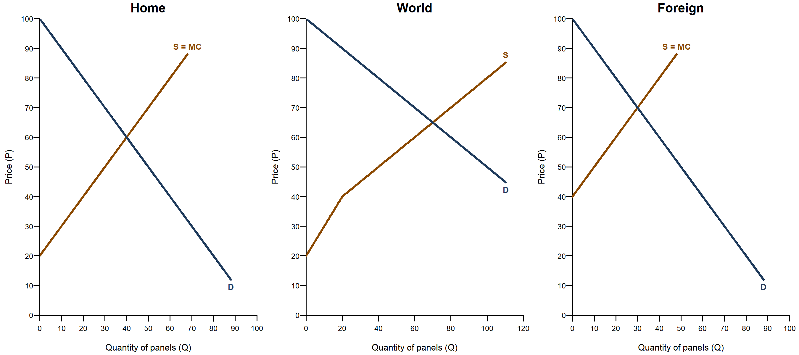
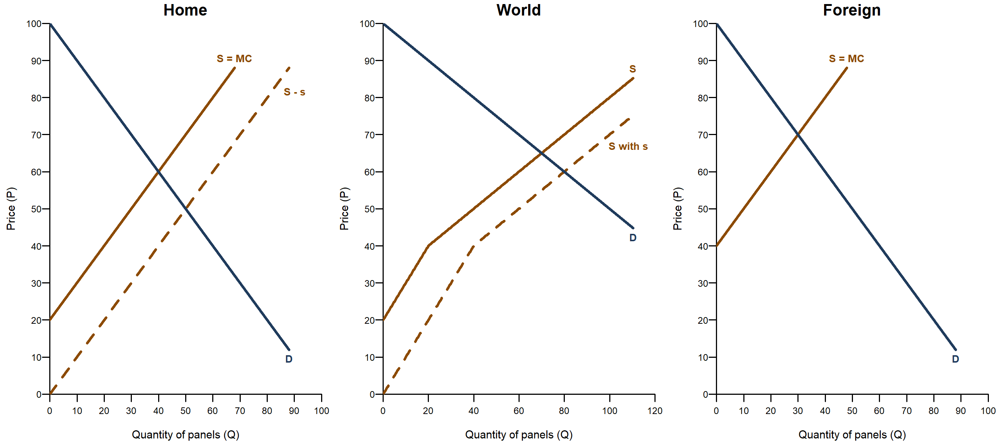
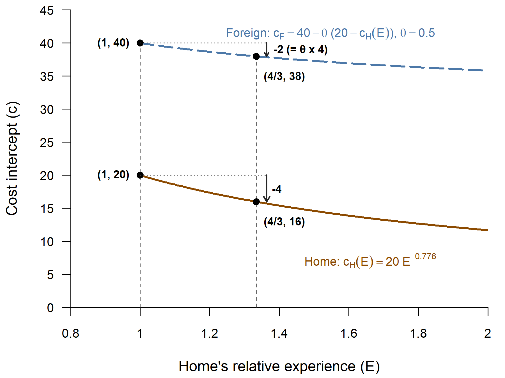
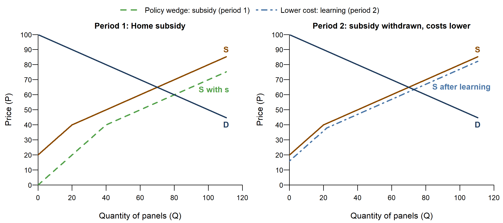

<!--
  NOTE FOR MAINTENANCE (this comment is not shown on the website)
  - The static figures are made by code/tutorial04_figures.R (run
    code/master.R in RStudio; Part 6 makes the Tutorial 4 figures). The
    market figures (fig01, fig02, fig05) exist in two versions, named after
    the two versions of the handout: _noanswers.png (handed out before the
    tutorial) and _answers.png (handed out after it). This page shows only
    the _noanswers versions and fig04 (one version: it shows only numbers
    the handout gives). The bar charts fig03, fig06 and fig07 exist only as
    _answers.png and are NOT shown here (they would give away the answers);
    the explorer's "Figure 6" view draws fig06 for any slider values.
  - The page has ONE app ({shinylive-r} chunk), the explorer. Shinylive
    apps must be self-contained, so the chunk contains two "files":
      app.R               - the user interface and server (written here)
      functions_models.R  - pulled in from ../code/functions_models.R by
                            Quarto's include shortcode when the site is
                            rendered (Part 7 there: Model F,
                            open_outcomes(), open_two_period(),
                            draw_open_market(), draw_open_period2(),
                            draw_open_bars()), so the app always uses the
                            same model and drawing code as the handout
                            figures.
  - The slider defaults are the handout values (list "handout" at the top
    of app.R): if the handout parameters in code/tutorial04_figures.R
    change, change them there too. The app draws the "answers" version
    (with numbers): students use it after working through the questions,
    and for Question 2.5 (the spillover slider).
  - Learning in the app: Home's period-2 cost intercept depends on how much
    the subsidy raised Home's period-1 output (E = output with / without
    the subsidy); the learning rate is calibrated so that s = 20 lowers it
    from 20 to 16, as in the handout. s = 0 means no learning at all.
  - To try the app on your computer as a normal Shiny app before pushing,
    switch on Part 14 (code/app_test.R) in code/master.R and set app_qmd to
    this page there (app_chunk = 1).
-->

Tutorials 1 to 3 looked at one market in one country. In Tutorial 4 the solar panel market opens up: two countries, Home and Foreign, trade panels freely, so there is one **world price**. Two things that coincided in the closed market now come apart. **Where panels are made** (production, set by each country's costs) differs from **where they are bought** (consumption, set by each country's demand); the difference is trade. And **national welfare** differs from **world welfare**: a policy can make one country better off and the other worse off, or the world as a whole poorer while one country gains. Exercise 1 adds a Home production subsidy; Exercise 2 asks what happens when that subsidy also triggers learning-by-doing whose benefits partly spill over to Foreign.

::: {.callout-note}
## How to use this page

- The page has **one interactive explorer**. It runs entirely in your browser. **The first time, it may take 10-30 seconds to load.**
- Choose a figure, then move the sliders: the diagram and the tables update immediately. The button "Reset to the handout values" brings back the handout case (s = 20, θ = 0.5, δ = 1).
- The explorer shows the numbers (the "answers" version of the figures): work through the handout questions first, then use it to check your answers and for **Question 2.5** (the spillover slider θ).
- Below the explorer, the **static figures** are the same as in the tutorial handout, each with the key idea in a few sentences.
:::

## The explorer {#explorer}

```{shinylive-r}
#| standalone: true
#| viewerHeight: 900

## file: app.R
# ---------------------------------------------------------------------------
# Tutorial 4 explorer: two countries, a Home production subsidy and
# international learning-by-doing (handout Figures 1-2 the three markets,
# Figure 5 period 1 versus period 2, Figure 6 two-period welfare). The
# figures are drawn by draw_open_market(), draw_open_period2() and
# draw_open_bars() in functions_models.R (bundled below): the same functions
# that make the handout PNGs. The tables use open_two_period(), which
# returns every number of the model.
# ---------------------------------------------------------------------------
library(shiny)
source("functions_models.R")   # open_outcomes(), open_two_period(), ...

# ---- Settings ---------------------------------------------------------------
# Model as in the handout: demand Q = 100 - P in each country, industry
# supply Home Q = P - 20, Foreign Q = P - 40 (10 firms each). The sliders
# change the subsidy s, the spillover share theta and the weight of
# period 2, delta. Fixed axes, a little taller than in the handout (price
# axis to 110 instead of 100), so that the price Home producers receive
# (up to 95 at s = 40) stays below the end of the drawn MC line. Numbered
# ticks as in the handout: every 10 on the country and price axes, every
# 20 on the World quantity axis. The welfare bars get a fixed range wide
# enough for every slider value (Home's -800 at s = 40, plus some space).
ax <- list(xlim_c = c(0, 100), xlim_w = c(0, 120), ylim = c(0, 110),
           ticks = list(c(10, 10), c(20, 10), c(10, 10)),  # Home, World, Foreign
           ticks_w = c(20, 10))                            # Figure 5 panels
bar_lim <- c(-900, 600)

# Handout values: every slider starts here; the Reset button comes back
handout <- list(s = 20, theta = 0.5, delta = 1)

view_choices <- c(
  "Figures 1-2 - the three markets (Home, World, Foreign)" = "markets",
  "Figure 5 - the world market, period 1 vs period 2"      = "period2",
  "Figure 6 - welfare over two periods"                    = "two_period")

# The key message of each view, shown above the plot
view_text <- c(
  markets = "One world price for both countries. Each country makes panels up to where its marginal cost equals the price it receives and buys them up to where its willingness to pay equals the world price; the gap between the two is trade. With the subsidy, Home's supply (in world-price terms) moves down by s. The red triangle is the world's loss: between Home's marginal cost and the thin dashed line, the demand Home's firms face on the world market (world demand minus Foreign's supply).",
  period2 = "Left: in period 1 the subsidy is a policy wedge: it lowers the world price, but not the true cost of making panels. Right: in period 2 the subsidy is gone, but learning has lowered the true costs, in Home and (through the spillover) in Foreign.",
  two_period = "Welfare changes relative to a world without the subsidy: period 1 (the subsidy), period 2 (learning, weighted by delta) and the total. The tables below add the environmental benefits.")

# ---- User interface: what students see ------------------------------------
ui <- fluidPage(
  sidebarLayout(
    sidebarPanel(
      width = 3,
      selectInput("view", "Figure", choices = view_choices,
                  selected = "markets"),
      conditionalPanel("input.view == 'markets'",
        radioButtons("state", NULL,
                     choices = c("Free trade (Figure 1)" = "free",
                                 "With the Home subsidy (Figure 2)" = "subsidy"),
                     selected = "free")),
      sliderInput("s", "Home subsidy per panel (s)",
                  min = 0, max = 40, value = handout$s, step = 5),
      sliderInput("theta", "Share of Home's learning that reaches Foreign (θ)",
                  min = 0, max = 1, value = handout$theta, step = 0.1),
      sliderInput("delta", "Weight of period 2 (δ)",
                  min = 0, max = 1, value = handout$delta, step = 0.1),
      helpText("Demand Q = 100 - P in each country; supply Home Q = P - 20,",
               "Foreign Q = P - 40. Learning: s = 20 lowers Home's cost",
               "intercept from 20 to 16; θ = 0.5 lowers Foreign's from 40",
               "to 38. Environment: 6 per new installation for the",
               "installing country, 12 for the world (split 50/50)."),
      actionButton("reset", "Reset to the handout values", class = "btn-sm")
    ),
    mainPanel(
      width = 9,
      # On a phone the plot is drawn wider than the screen and scaled down
      # (see plot_width below), so that its labels do not run into each other
      tags$style("#fig_plot img { max-width: 100%; height: auto; }"),
      uiOutput("fig_text"),
      plotOutput("fig_plot", height = "auto"),
      uiOutput("cost_text"),
      tableOutput("market_table"),
      tableOutput("welfare_table")
    )
  )
)

# ---- Helpers: the tables of numbers -----------------------------------------
fmt_num <- function(x) {
  if (is.null(x) || length(x) != 1 || is.na(x)) return("-")
  chain_fmt(x)
}
fmt_change <- function(x) {          # "+187.5", "-150", "0"
  if (is.null(x) || length(x) != 1 || is.na(x)) return("-")
  if (round(x, 2) > 0) paste0("+", chain_fmt(x)) else chain_fmt(x)
}
fmt_trade <- function(o) {           # Home's net exports, or "no trade"
  if (o$no_market || abs(o$X) < 1e-9) return("no trade")
  if (o$X > 0) paste0("Home exports ", chain_fmt(o$X))
  else paste0("Foreign exports ", chain_fmt(-o$X))
}

# Prices, production, consumption and trade in the three situations
market_table <- function(tp) {
  st <- list(tp$A1, tp$B1, tp$B2)
  row <- function(f) vapply(st, function(o) f(o), "")
  out <- rbind(
    "World price (P_W)"              = row(function(o) fmt_num(o$P_W)),
    "Price Home producers receive"   = row(function(o) fmt_num(o$P_HP)),
    "Home: panels made"              = row(function(o) fmt_num(o$Q_HS)),
    "Home: panels bought"            = row(function(o) fmt_num(o$Q_HD)),
    "Foreign: panels made"           = row(function(o) fmt_num(o$Q_FS)),
    "Foreign: panels bought"         = row(function(o) fmt_num(o$Q_FD)),
    "Trade"                          = row(fmt_trade))
  data.frame(Measure = rownames(out),
             "Free trade (no subsidy)" = out[, 1],
             "Period 1: with the subsidy" = out[, 2],
             "Period 2: after learning" = out[, 3],
             check.names = FALSE, row.names = NULL)
}

# Welfare changes relative to the path without the subsidy
welfare_table <- function(tp) {
  t <- tp$table
  col <- function(r) vapply(c("Home", "Foreign", "World"),
                            function(j) fmt_change(t[r, j]), "")
  data.frame(
    "Change in welfare" = c("Home", "Foreign", "World"),
    "Period 1 (subsidy)" = col("p1"),
    "Period 2 (learning, x δ)" = col("p2"),
    "Total" = col("total"),
    "Environment (both periods)" = col("env"),
    "Total with environment" = col("total_env"),
    check.names = FALSE, row.names = NULL)
}

# ---- Server: what happens when a slider moves -----------------------------
server <- function(input, output, session) {

  # Reset: every input back to its handout value
  observeEvent(input$reset, {
    for (nm in names(handout)) {
      updateSliderInput(session, nm, value = handout[[nm]])
    }
  })

  # All the numbers for the current slider values (NULL if they cannot be
  # computed; the plot then says so)
  model <- reactive({
    tryCatch(open_two_period(s = input$s, theta = input$theta,
                             delta = input$delta),
             error = function(e) NULL)
  })

  output$fig_text <- renderUI({
    p(view_text[[input$view]], style = "margin-bottom: 6px;")
  })

  # Plot size: the width of the page column, but at least 760 pixels (on a
  # phone the picture is then scaled down to fit); the height follows the
  # width (three panels side by side need a wide, low picture)
  plot_width <- function() {
    w <- session$clientData$output_fig_plot_width
    if (is.null(w) || w <= 0) 800 else max(w, 760)
  }
  plot_height <- function() min(460, round(0.45 * plot_width() + 20))

  output$fig_plot <- renderPlot({
    # tryCatch: if a combination of values cannot be drawn, say so in the
    # plot area instead of showing an R error
    tryCatch({
      if (input$view == "markets") {
        draw_open_market(state = input$state, version = "answers",
                         s = input$s, xlim_c = ax$xlim_c,
                         xlim_w = ax$xlim_w, ylim = ax$ylim,
                         tick_step = ax$ticks)
      } else if (input$view == "period2") {
        draw_open_period2(version = "answers", theta = input$theta,
                          s = input$s, xlim = ax$xlim_w, ylim = ax$ylim,
                          tick_step = ax$ticks_w)
      } else {
        draw_open_bars(type = "two_period", version = "answers",
                       s = input$s, theta = input$theta,
                       delta = input$delta, lim = bar_lim, tick = 100)
      }
    }, error = function(e) {
      op <- par(mar = c(0, 0, 0, 0)); on.exit(par(op))
      plot.new()
      text(0.5, 0.5, paste0("This combination of values cannot be drawn:\n",
                            conditionMessage(e),
                            "\nPlease try other slider values."), cex = 0.95)
    })
  }, res = 96, width = plot_width, height = plot_height)

  output$cost_text <- renderUI({
    tp <- model()
    if (is.null(tp)) return(NULL)
    p(paste0("Period-2 cost intercepts after learning: Home ",
             chain_fmt(tp$cH2), " (was 20), Foreign ", chain_fmt(tp$cF2),
             " (was 40)."), style = "margin: 6px 0;")
  })

  output$market_table <- renderTable({
    tp <- model()
    if (is.null(tp)) return(NULL)
    market_table(tp)
  }, striped = TRUE, spacing = "xs", width = "100%", align = "lrrr")

  output$welfare_table <- renderTable({
    tp <- model()
    if (is.null(tp)) return(NULL)
    welfare_table(tp)
  }, striped = TRUE, spacing = "xs", width = "100%", align = "lrrrrr")
}

shinyApp(ui, server)

## file: functions_models.R

```

## The figures of the handout

### Exercise 1: free trade between Home and Foreign

Both countries have the same demand, Q = 100 - P, but Foreign's panels cost more to make: Home's industry supply is Q = P - 20, Foreign's Q = P - 40. World demand is the sum of the two demands, world supply the sum of the two supplies at each price. Below a price of 40 only Home produces, which puts a kink into world supply (Walkthrough 2). The world price is where world demand meets world supply (Question 1.3); at that price, read off each country's production and consumption (Question 1.4).

{fig-alt="Three panels side by side, Home, World and Foreign, with the same price axis from 0 to 100. Home: demand D falling from 100 and supply S = MC rising from 20. World: demand D falling from 100 with half the slope, and a kinked supply S rising from 20, steeper up to a quantity of 20 and flatter after. Foreign: demand D falling from 100 and supply S = MC rising from 40." width="100%"}

*Explore: choose **Figures 1-2** and **Free trade** in the [explorer](#explorer) above.*

### Exercise 1: a Home production subsidy

Home pays s = 20 on every panel made in Home, whether it is sold at home or exported. A Home firm now receives the world price plus s, so at every world price it offers more panels: drawn against the world price, Home's supply moves down by s (S - s, Question 1.6), and so does the Home part of world supply. Foreign's supply does not change. Compare the new world price, production, consumption and trade in both countries with free trade (Question 1.7), then the welfare ledger: who gains, who loses, and why the world as a whole is poorer (Questions 1.8 and 1.9).

{fig-alt="The three panels of Figure 1. Home now also shows a dashed supply curve S - s, parallel to S = MC and 20 lower. The World panel also shows a dashed world supply S with s, below the original. The Foreign panel is unchanged." width="100%"}

Careful: in the Home panel the dashed S - s crosses Home's own demand at Q = 50, but that crossing means nothing in an open economy. Home's firms sell on the world market, so the price is set in the World panel; Home's panel only shows how much Home makes and buys at that price.

*Explore: choose **Figures 1-2** and **With the Home subsidy**, then move the subsidy s.*

### Exercise 2: learning-by-doing that crosses borders

The subsidy lasts one period only, but the extra panels Home made in period 1 raise its experience by a third (E = 60/45 = 4/3), and learning lowers Home's cost intercept from 20 to 16. A share θ of that cost reduction reaches Foreign's producers, through workers, equipment suppliers or imitation; with θ = 0.5 Foreign's intercept falls from 40 to 38.

{fig-alt="Two falling curves against Home's relative experience E. Home's cost intercept falls from 20 at E = 1 to 16 at E = 4/3 (a fall of 4). Foreign's, dashed and higher, falls from 40 to 38 at E = 4/3 (a fall of 2, half of Home's 4 with theta = 0.5)." width="85%"}

In period 2 both countries face the true, lower costs and no subsidy. In the world market that looks similar to the subsidy, since world supply moves out in both cases, but the two shifts mean different things. The subsidy is a *policy wedge*: it lowers the price buyers pay, but every extra panel still costs as much to make as before. Learning *lowers the cost itself* (Question 2.2).

{fig-alt="Two World panels side by side. Left, period 1: world demand D, world supply S and the dashed green world supply with the subsidy. Right, period 2: the same demand and S, and a blue dash-dot world supply after learning, slightly below S." width="100%"}

*Explore: choose **Figure 5**, then **Figure 6** for the welfare changes over both periods. The tables under the plot add the environmental benefits (Question 2.6).*

## Things to try

1. **How big is the spillover? (Question 2.5).** Keep s = 20 and δ = 1, choose Figure 6 and set θ to 0.2, then 0.8. Read the two-period totals for Home, Foreign and the World from the welfare table and enter them in the handout table. Who gains when θ rises, and who loses a little?
2. **Doubling the subsidy.** In Figures 1-2 (with the subsidy), set s = 10, 20 and 40. How does the world loss in period 1 (the red triangle, and the World entry in the first column of the welfare table) grow when the subsidy doubles?
3. **Is the future worth less?** Set s = 20 and θ = 0.5, then lower the weight of period 2, δ, from 1 in steps of 0.1. Between which two slider values does the world's two-period total turn negative, and why does a lower δ have this effect? Does Home's total ever become positive for any δ?
4. **Does the environment change the verdict?** With the handout values, compare the "Total" and "Total with environment" columns. Then try s = 40: is Home better off with the subsidy once the environmental benefits are counted, and is the world?
