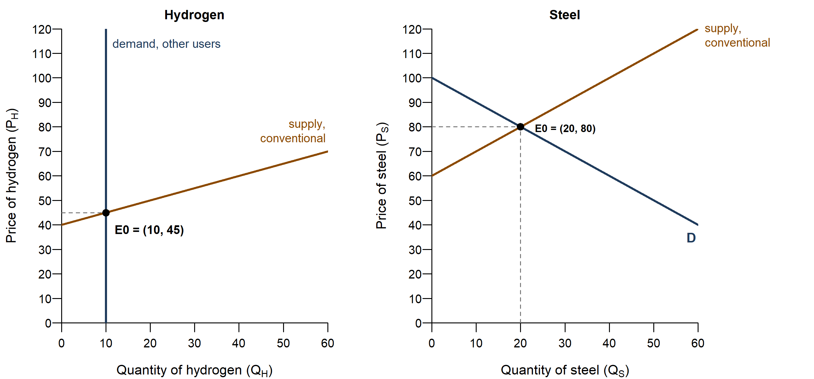
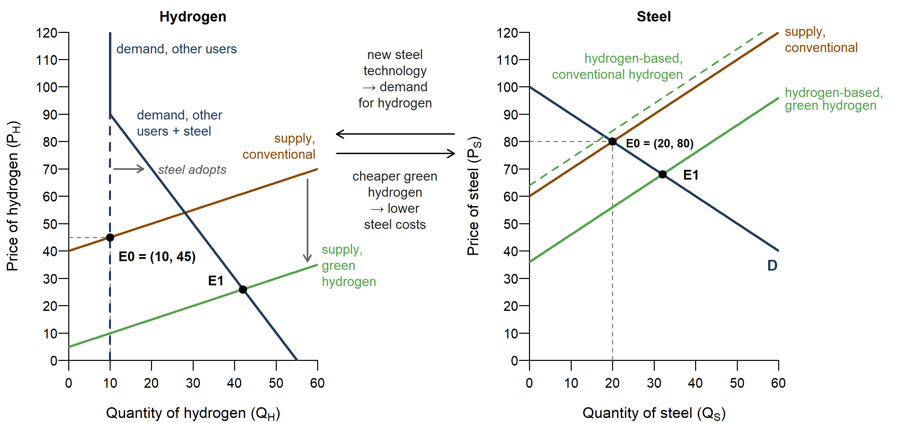
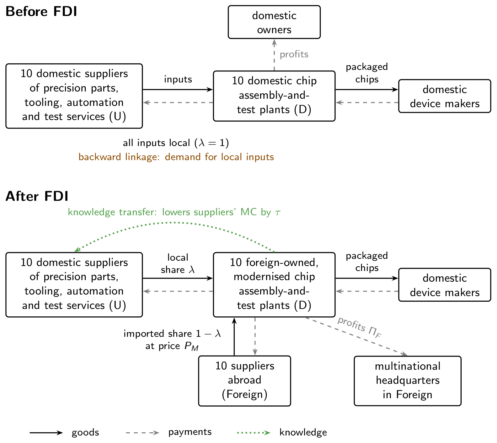
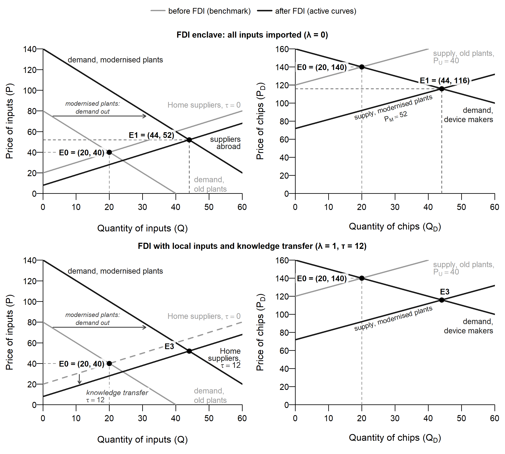

<!--
  NOTE FOR MAINTENANCE (this comment is not shown on the website)
  - The static figures are made by code/tutorial05_figures.R (run
    code/master.R in RStudio; Part 7 makes the Tutorial 5 figures), except
    Figure 3 (the value-chain schematic), which is drawn in TikZ
    (Latex slides/PEIB/tutorial05_figures.tex). Figures 1, 2 and 4 exist in
    two versions, named after the two versions of the handout:
    _noanswers.png (before the tutorial) and _answers.png (after it). This
    page shows only the _noanswers versions and fig03 (one version).
  - The page has TWO apps ({shinylive-r} chunks): Explorer A (Exercise 1,
    hydrogen and steel) and Explorer B (Exercise 2, FDI and local
    suppliers). Each loads its own R engine in the browser. Shinylive apps
    must be self-contained, so each chunk contains two "files":
      app.R               - the user interface and server (written here)
      functions_models.R  - pulled in from ../code/functions_models.R by
                            Quarto's include shortcode when the site is
                            rendered (Part 8 there: Model G,
                            h2_outcomes(), draw_h2_steel(),
                            fdi_outcomes(), draw_fdi_scenarios()), so the
                            apps use the same model and drawing code as the
                            handout figures.
  - The model has no free parameters in the apps: Explorer A switches the
    two investments on and off (four cases), Explorer B switches the input
    source (lambda = 0 or 1) and, with local inputs, moves the knowledge
    transfer tau from 0 to 12. Both draw the "answers" version (with
    numbers): students use them after working through the questions.
  - To try an app on your computer as a normal Shiny app before pushing,
    switch on Part 14 (code/app_test.R) in code/master.R and set app_qmd to
    this page there (app_chunk = 1 or 2).
-->

Tutorials 2 to 4 linked markets through prices: a cheaper input lowers the cost of the product that uses it. Tutorial 5 asks what happens when an investment in one sector only pays off if another sector invests too. In **Exercise 1** a new steel process needs hydrogen, and green hydrogen only pays off if steel buys it: each sector's investment raises the other's profit, through a **backward (demand) linkage** and a **forward (cost) linkage**, so both can be stuck in a status quo that is worse for both. In **Exercise 2** a multinational modernises the chip assembly-and-test plants in Home. Whether Home gains much depends on **where the plants buy their inputs** (from local suppliers or from suppliers abroad) and on whether the multinational **transfers knowledge** that lowers its local suppliers' costs, and on **who owns** each surplus: Home or Foreign.

::: {.callout-note}
## How to use this page

- The page has **two interactive explorers**, one per exercise. They run entirely in your browser. **The first time, each may take 10-30 seconds to load.**
- Tick the boxes or move the slider: the diagrams and the tables update immediately.
- The explorers show the numbers (the "answers" version of the figures): work through the handout questions first, then use them to check your answers.
- Below each explorer, the **static figures** are the same as in the tutorial handout, each with the key idea in a few sentences.
:::

## Explorer A: hydrogen and steel {#explorer-a}

```{shinylive-r}
#| standalone: true
#| viewerHeight: 820

## file: app.R
# ---------------------------------------------------------------------------
# Tutorial 5, Explorer A: two linked investments. The hydrogen sector can
# switch to green hydrogen (fixed cost 180), the steel sector to a
# hydrogen-based process (fixed cost 150). The figure is drawn by
# draw_h2_steel() and the numbers come from h2_outcomes() in
# functions_models.R (bundled below): the same functions that make the
# handout PNGs (Figures 1 and 2).
# ---------------------------------------------------------------------------
library(shiny)
source("functions_models.R")   # h2_outcomes(), draw_h2_steel(), ...

case_text <- function(steel, green) {
  if (!steel && !green) {
    "Status quo: the other users buy 10 units of hydrogen whatever the price; steel uses the conventional process."
  } else if (!steel && green) {
    "Only hydrogen invests: green hydrogen is cheaper to make, but nobody buys more of it, so the price falls and the sector cannot cover the fixed cost."
  } else if (steel && !green) {
    "Only steel invests: its demand pushes up the price of conventional hydrogen, so the new steel process ends up dearer than the old one."
  } else {
    "Both invest: steel's demand makes green hydrogen worth producing (backward linkage), and cheap green hydrogen makes the new steel process worth using (forward linkage)."
  }
}

ui <- fluidPage(
  sidebarLayout(
    sidebarPanel(
      width = 3,
      checkboxInput("steel", "Steel adopts the hydrogen-based process",
                    value = FALSE),
      checkboxInput("green", "Hydrogen sector invests in green hydrogen",
                    value = FALSE),
      checkboxInput("areas", "Show producer surplus areas", value = TRUE),
      helpText("Hydrogen supply: conventional P = 40 + Q/2, green",
               "P = 5 + Q/2. Other users buy 10 units. Steel demand",
               "P = 100 - Q; steel supply conventional P = 60 + Q,",
               "hydrogen-based P = 10 + (price of hydrogen) + Q.",
               "Fixed costs: green hydrogen 180, hydrogen-based steel 150.")
    ),
    mainPanel(
      width = 9,
      tags$style("#fig_plot img { max-width: 100%; height: auto; }"),
      uiOutput("case_text"),
      plotOutput("fig_plot", height = "auto"),
      tableOutput("market_table"),
      tableOutput("payoff_table")
    )
  )
)

server <- function(input, output, session) {
  output$case_text <- renderUI({
    p(case_text(input$steel, input$green), style = "margin-bottom: 6px;")
  })

  # At least 760 pixels wide (scaled down on a phone), height from width
  plot_width <- function() {
    w <- session$clientData$output_fig_plot_width
    if (is.null(w) || w <= 0) 800 else max(w, 760)
  }
  plot_height <- function() round(0.47 * plot_width())

  output$fig_plot <- renderPlot({
    draw_h2_steel("custom", "answers", steel = input$steel,
                  green = input$green, show_areas = input$areas, mid = 1.3)
  }, res = 96, width = plot_width, height = plot_height)

  # Prices, quantities and surpluses: status quo and the case chosen
  output$market_table <- renderTable({
    o0 <- h2_outcomes(FALSE, FALSE)
    o1 <- h2_outcomes(input$steel, input$green)
    rows <- c("Hydrogen: quantity (Q_H)" = "Q_H", "Hydrogen: price (P_H)" = "P_H",
              "Steel: quantity (Q_S)" = "Q_S", "Steel: price (P_S)" = "P_S",
              "Hydrogen: producer surplus" = "PS_H",
              "Steel: producer surplus" = "PS_S",
              "Hydrogen: net of fixed cost" = "Pi_H",
              "Steel: net of fixed cost" = "Pi_S")
    data.frame(Measure = names(rows),
               "Status quo" = vapply(rows, function(v) chain_fmt(o0[[v]]), ""),
               "Case shown" = vapply(rows, function(v) chain_fmt(o1[[v]]), ""),
               check.names = FALSE, row.names = NULL)
  }, striped = TRUE, spacing = "xs", width = "100%", align = "lrr")

  # The four cases: net producer surplus (hydrogen, steel)
  output$payoff_table <- renderTable({
    cell <- function(st, gr) {
      o <- h2_outcomes(st, gr)
      paste0(chain_fmt(o$Pi_H), " / ", chain_fmt(o$Pi_S))
    }
    data.frame(
      "Net surplus: hydrogen / steel" = c("Hydrogen stays conventional",
                                          "Hydrogen invests (green)"),
      "Steel stays conventional" = c(cell(FALSE, FALSE), cell(FALSE, TRUE)),
      "Steel invests (hydrogen-based)" = c(cell(TRUE, FALSE), cell(TRUE, TRUE)),
      check.names = FALSE)
  }, striped = TRUE, spacing = "xs", width = "100%", align = "lcc")
}

shinyApp(ui, server)

## file: functions_models.R

```

### Exercise 1: the status quo

Neither sector has invested. The other industrial users buy 10 units of hydrogen whatever the price, so the quantity is fixed by demand (a vertical line) and the price is read off the conventional supply curve. Steel is an ordinary market, as in Tutorial 1.

{fig-alt="Two panels. Left, hydrogen: a vertical demand line of the other users at a quantity of 10 and a conventional supply curve rising from 40 with slope one half; they meet at E0 = (10, 45). Right, steel: demand falling from 100 and conventional supply rising from 60; they meet at E0 = (20, 80)." width="100%"}

### Exercise 1: joint investment

If steel adopts the hydrogen-based process, every unit of steel needs a unit of hydrogen: steel's demand is added to the other users' 10 units, so the demand for hydrogen moves out (Question 1.2). If the hydrogen sector also switches to green hydrogen, its supply curve moves down, the price of hydrogen falls, and so does the cost of hydrogen-based steel (Question 1.3). The dashed line shows the steel supply if steel invested alone and had to buy conventional hydrogen: it lies above the old supply curve.

{fig-alt="The two panels of Figure 1 with the joint-investment curves added. Left: the kinked demand of the other users plus steel, falling from (10, 90) to (55, 0), and the green-hydrogen supply rising from 5, 35 below the conventional one; they meet at E1. Right: a hydrogen-based steel supply with green hydrogen, below the conventional one, meets demand at E1, and a dashed hydrogen-based supply with conventional hydrogen lies just above the conventional one. Between the panels two arrows: new steel technology creates demand for hydrogen, cheaper green hydrogen lowers steel costs." width="100%"}

*Explore: tick one box at a time in [Explorer A](#explorer-a), then both. The table under the plot gives the four cases of the handout's payoff table (Table 4).*

## Explorer B: FDI and local suppliers {#explorer-b}

```{shinylive-r}
#| standalone: true
#| viewerHeight: 860

## file: app.R
# ---------------------------------------------------------------------------
# Tutorial 5, Explorer B: FDI in chip assembly-and-test plants. The
# modernised, foreign-owned plants buy all their inputs either from local
# suppliers in Home (lambda = 1) or from suppliers abroad (lambda = 0).
# With local sourcing, a knowledge transfer tau lowers the local suppliers'
# cost. The figure is drawn by draw_fdi_scenarios() and the numbers come
# from fdi_outcomes() in functions_models.R (bundled below), the same
# functions that make the handout's Figure 4.
# ---------------------------------------------------------------------------
library(shiny)
source("functions_models.R")   # fdi_outcomes(), draw_fdi_scenarios(), ...

ui <- fluidPage(
  sidebarLayout(
    sidebarPanel(
      width = 3,
      radioButtons("source", "Where do the modernised plants buy their inputs?",
                   choices = c("From suppliers abroad (λ = 0)" = "0",
                               "From local suppliers in Home (λ = 1)" = "1"),
                   selected = "0"),
      conditionalPanel("input.source == '1'",
        sliderInput("tau", "Knowledge transfer: cut in local suppliers' cost (τ)",
                    min = 0, max = 12, value = 0, step = 1)),
      checkboxInput("areas", "Show surpluses by owner", value = TRUE),
      helpText("Chip demand P = 160 - Q. Local suppliers P = 20 - τ + Q,",
               "suppliers abroad P = 8 + Q. Plants before FDI:",
               "P = 80 + input price + Q (Home-owned); after FDI:",
               "P = 20 + input price + Q (foreign-owned). One input per chip.")
    ),
    mainPanel(
      width = 9,
      tags$style("#fig_plot img { max-width: 100%; height: auto; }"),
      plotOutput("fig_plot", height = "auto"),
      tableOutput("market_table"),
      tableOutput("welfare_table")
    )
  )
)

# "n/a" where a market has no transactions (e.g. the local input price in
# the enclave)
fmt <- function(x) if (is.null(x) || is.na(x)) "n/a" else chain_fmt(x)

server <- function(input, output, session) {
  lam <- reactive(as.numeric(input$source))
  tau <- reactive(if (lam() == 1) input$tau else 0)
  model <- reactive(fdi_outcomes(TRUE, lam(), tau()))

  plot_width <- function() {
    w <- session$clientData$output_fig_plot_width
    if (is.null(w) || w <= 0) 800 else max(w, 760)
  }
  plot_height <- function() round(0.52 * plot_width())

  output$fig_plot <- renderPlot({
    draw_fdi_scenarios(list(c(lam(), tau())), version = "answers",
                       show_areas = input$areas)
  }, res = 96, width = plot_width, height = plot_height)

  output$market_table <- renderTable({
    o0 <- fdi_outcomes(FALSE); o1 <- model()
    rows <- c("Chips: quantity (Q_D)" = "Q_D", "Chips: price (P_D)" = "P_D",
              "Inputs from local suppliers (Q_U)" = "Q_U",
              "Inputs from abroad (Q_M)" = "Q_M",
              "Price of local inputs (P_U)" = "P_U",
              "Price of imported inputs (P_M)" = "P_M")
    data.frame(Measure = names(rows),
               "No FDI" = vapply(rows, function(v) fmt(o0[[v]]), ""),
               "With FDI (case shown)" = vapply(rows, function(v) fmt(o1[[v]]), ""),
               check.names = FALSE, row.names = NULL)
  }, striped = TRUE, spacing = "xs", width = "100%", align = "lrr")

  output$welfare_table <- renderTable({
    o0 <- fdi_outcomes(FALSE); o1 <- model()
    rows <- c("Home: device makers (CS_D)" = "CS_D",
              "Home: local suppliers (PS_U)" = "PS_U",
              "Home: plants' owners, before FDI (PS_D)" = "PS_D",
              "Foreign: multinational's plants (Pi_F)" = "Pi_F",
              "Foreign: suppliers abroad (PS_M)" = "PS_M",
              "Home welfare (W_H)" = "W_H",
              "Foreign welfare (W_F)" = "W_F",
              "World welfare (W_W)" = "W_W")
    data.frame(Surplus = names(rows),
               "No FDI" = vapply(rows, function(v) fmt(o0[[v]]), ""),
               "With FDI (case shown)" = vapply(rows, function(v) fmt(o1[[v]]), ""),
               check.names = FALSE, row.names = NULL)
  }, striped = TRUE, spacing = "xs", width = "100%", align = "lrr")
}

shinyApp(ui, server)

## file: functions_models.R

```

### Exercise 2: the value chain before and after FDI

Before FDI, ten Home-owned plants assemble and test chips with inputs from ten local suppliers. After FDI the plants are foreign-owned and modernised: their own costs fall, so they produce more and need more inputs. Three channels decide how much of that reaches Home: the **backward linkage** (are the inputs bought locally, share λ, or imported?), **knowledge transfer** (does the multinational help its local suppliers cut costs, by τ?) and **ownership** (the plants' profit Π_F goes to Foreign).

{fig-alt="Schematic of the value chain. Before FDI: domestic suppliers deliver inputs to domestic chip plants, which deliver packaged chips to domestic device makers; payments flow back and profits go to domestic owners. After FDI: the plants are foreign-owned and modernised; inputs come from local suppliers (share lambda) or from suppliers abroad (share 1 - lambda); a dotted knowledge-transfer arrow runs from the plants to the local suppliers; profits go to the multinational's headquarters in Foreign." width="100%"}

### Exercise 2: two FDI scenarios in the two markets

Each row shows the market for inputs (left) and the chip market (right). Grey is the situation before FDI, black the curves after it. In the **enclave** (top row) the plants import all their inputs: Home's suppliers sell nothing. With **local inputs and knowledge transfer** (bottom row) the local suppliers' supply curve moves down by τ = 12. Compare the prices and quantities in the two rows (Question 2.2), then ask who owns each surplus (Questions 2.4 and 2.5).

{fig-alt="Two rows of two panels. Every panel shows the no-FDI curves in grey: in the input market the demand of the old plants falling from 80 and the Home suppliers' supply rising from 20, meeting at E0 = (20, 40); in the chip market demand falling from 160 and the old plants' supply rising from 120, meeting at E0 = (20, 140). Top row, FDI enclave: the modernised plants' input demand falling from 140 meets the supply of suppliers abroad rising from 8 at E1 = (44, 52); in the chip market the modernised plants' supply rising from 72 meets demand at E1 = (44, 116). Bottom row, local inputs with knowledge transfer: the Home suppliers' supply moves down from 20 + Q (dashed) to 8 + Q and meets the new input demand at E3; in the chip market the modernised plants' supply meets demand at E3." width="100%"}

*Explore: in [Explorer B](#explorer-b), switch between suppliers abroad and local suppliers, then move τ from 0 to 12.*

## Things to try

1. **Who blocks whom? (Exercise 1).** In Explorer A tick only "Steel adopts". What happens to the price of hydrogen, and is steel's investment still worth its fixed cost of 150? Then tick only "Hydrogen sector invests". Why does the hydrogen sector lose money although its costs fell?
2. **Two self-sustaining outcomes.** Using the payoff table under Explorer A, check that neither sector wants to invest alone if the other does not, but each wants to invest if the other does. Which mechanisms in the handout (Question 1.5) could move both sectors from the status quo to joint investment?
3. **Local content without knowledge transfer (Exercise 2).** In Explorer B choose local suppliers and keep τ = 0 (the scenario of Appendix B.4). Compare Home, Foreign and world welfare with the enclave. Who gains, who loses, and why is the world poorer?
4. **How much transfer is enough?** With local suppliers, move τ from 0 to 12 in steps of 1. At which τ does world welfare reach the enclave's 2,904? Compare the enclave and τ = 12: prices and quantities are identical, so what exactly differs between the two rows of the welfare table?
